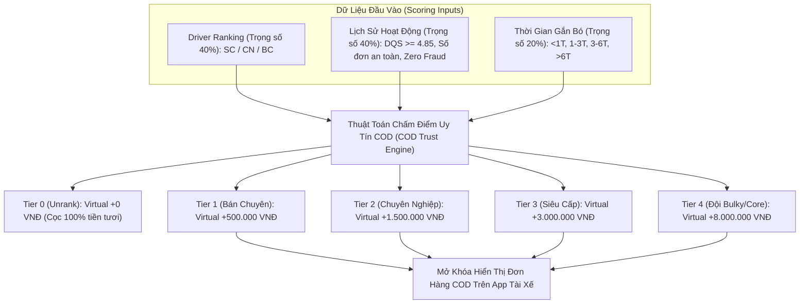
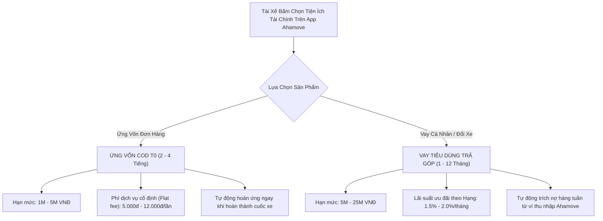
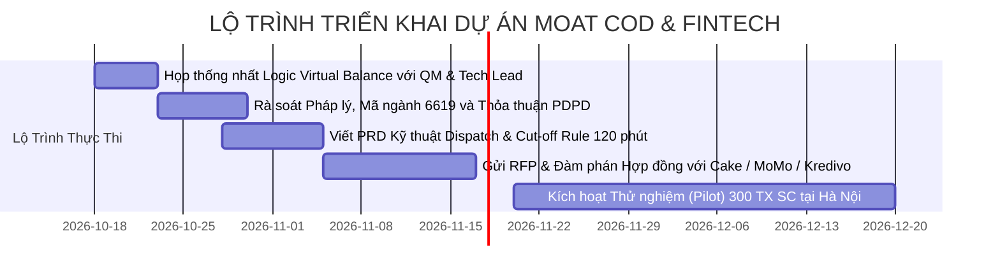

# ĐỀ ÁN CHIẾN LƯỢC MOAT 2027: TỐI ƯU HÓA COD BALANCE & GIẢI PHÁP TÀI CHÍNH NHÚNG (EMBEDDED FINTECH)

> **Người thực hiện:** Lê Phương Khanh (@Lephuongkhanh) — Driver Management & Strategy Division  
> **Người nhận (Kính gửi):** Anh Quang Minh (@QuangMinh - Head of Product / QM) & Ban Giám Đốc (BOD)  
> **Mục tiêu đề án:** Xây dựng hàng rào cạnh tranh (Moat) độc quyền của Ahamove: Giải quyết triệt để bài toán đứt gãy nguồn cung đơn COD cao thông qua **Cơ chế Hạn mức Ký quỹ Tín chấp (Virtual COD Overdraft)** và **Tích hợp Đối tác Tài chính (Embedded FinTech)**.  
> **Định dạng:** Chuẩn cấu trúc tài liệu doanh nghiệp Lark Docs (Kim tự tháp S-C-R).

---

## 1. TÓM TẮT THỰC THI (EXECUTIVE SUMMARY)

* 📊 **Thực Trạng & Vấn Đề Cốt Lõi (Situation & Complication):**
  * Mô hình ký quỹ COD hiện tại của Ahamove là **"100% Tiền Thật" (Hard Balance Barrier)**: Tài xế muốn nhận đơn COD giá trị bao nhiêu thì số dư ví bắt buộc phải $\ge$ bấy nhiêu.
  * **Hậu quả vận hành:** Tại Hà Nội, **gần 85% tài xế active có số dư ví dưới 1 triệu** (thậm chí 19.1% dưới 200k không thể chạy bất kỳ đơn COD nào). Lực lượng tài xế có balance $\ge$ 1M chỉ vỏn vẹn **717 tài xế (15.5%)**; tài xế balance $\ge$ 3M chỉ có **118 tài xế (2.5%)**.
  * **Đứt gãy tỷ lệ hoàn thành (FR Collapse):** Tỷ lệ đáp ứng đơn COD > 3M tại HAN rơi tự do xuống **23.2% – 33.6%** (đáy lịch sử từng chạm 2.3% so với SGN ổn định ở mức 54.2% – 58.3%). Doanh thu COD thất thoát (Lost GMV) lên tới **~165 Tỷ VNĐ/tháng** do khách đặt nhưng không có tài xế nhận cuốc.
* 🎯 **Giải Pháp Đề Xuất (Resolution - Moat 2027):**
  1. **Trụ cột 1 — Nâng cấp COD Balance (Chính sách Tín chấp Nội bộ):** Cấp **Hạn Mức Ký Quỹ Động (Virtual COD Overdraft)** từ `+500k` đến `+8.0M VNĐ` dựa trên ma trận 3 chiều: *Driver Ranking (SC - CN)* $\times$ *DQS & Lịch sử chạy an toàn* $\times$ *Thâm niên*.
  2. **Trụ cột 2 — Giải pháp Tài chính trong ngày (Embedded FinTech Partnership):** Tích hợp đối tác tổ chức tín dụng cấp phép (Ngân hàng số Cake by VPBank / Kredivo / MoMo) để cung cấp **Ứng vốn COD T0 siêu tốc (phí cố định 5k–12k/lần)** và **Vay tiêu dùng cá nhân trả góp (lãi suất ưu đãi 18%–24%/năm)** trừ dần qua ví thu nhập.
* 📈 **Chỉ Số Thành Công Đo Lường Được (Target Impact):**
  * Tăng **+220%** lượng tài xế đủ điều kiện nhận đơn COD $\ge$ 1M tại HAN (từ 717 lên 2,300+ tài xế).
  * Kéo Fulfillment Rate đơn COD 1M–2M từ 34.5% lên **$\ge$ 55.0%**; đơn > 3M từ 23.2% lên **$\ge$ 45.0% – 50.0%**.
  * Cứu vãn ước tính **+35 – 45 Tỷ VNĐ GMV/tháng**, tăng trực tiếp Take-rate và giữ chân tài xế nòng cốt (giảm Churn rate xuống <8%/quý).

---

## 2. PHẦN 1: PHƯƠNG ÁN & LOGIC CẢI THIỆN COD BALANCE (TRAO ĐỔI VỚI QM)

### 2.1. Logic Cốt Lõi: Sức Mua COD Khả Dụng (Effective COD Balance)
Chuyển đổi nguyên tắc kiểm tra điều kiện nhận đơn trên hệ thống Dispatch từ kiểm tra tiền cọc vật lý sang kiểm tra hạn mức uy tín:

$$\mathbf{Sức\ Mua\ COD\ Khả\ Dụng} = \mathbf{Ví\ Ký\ Quỹ\ Thực\ (Cash\ Balance)} + \mathbf{Hạn\ Mức\ Tín\ Chấp\ Ảo\ (Virtual\ Overdraft)}$$

*Ví dụ:* Tài xế Chuyên Nghiệp (CN) chỉ có 500.000 VNĐ tiền mặt trong ví, nhưng được cấp hạn mức ảo `+1.500.000 VNĐ`. Hệ thống tự động nhận diện tài xế có hạn mức khả dụng **2.000.000 VNĐ** $\rightarrow$ Đủ điều kiện hiển thị và nhận đơn COD 1.5M – 2.0M ngay lập tức.

---

### 2.2. Ma Trận Cấp Hạn Mức Chi Tiết (Credit Allocation Matrix)

| Hạng Tài Xế (Rank) | Thâm Niên (Tenure) | Tiêu Chí Gác Cổng (Gatekeeping Rules) | Ví Thực Tối Thiểu (Min Cash) | Hạn Mức Tín Chấp Ảo Cấp Thêm | Tổng COD Max Được Nhận | Cơ Chế Kiểm Soát Rủi Ro |
| :--- | :--- | :--- | :--- | :--- | :--- | :--- |
| **Tân Binh (Unrank)** | < 1 tháng | Hoàn thành đào tạo COD; 0 vi phạm quy chế | 100% giá trị COD | **+ 0 VNĐ** | = Số dư thực | Chưa cấp tín chấp |
| **Bán Chuyên (BC)** | $\ge$ 1 tháng | $\ge$ 30 đơn COD an toàn; DQS $\ge$ 4.80 | 300.000 VNĐ | **+ 500.000 VNĐ** | Lên tới 1.500.000 VNĐ | Auto-freeze nhận đơn sau 120 phút nếu chưa nộp tiền |
| **Chuyên Nghiệp (CN)** | $\ge$ 3 tháng | $\ge$ 100 đơn COD an toàn; DQS $\ge$ 4.85; 0 nợ xấu | 500.000 VNĐ | **+ 1.500.000 VNĐ** | Lên tới 3.000.000 VNĐ | Khấu trừ tự động ví thu nhập & thưởng tuần |
| **Siêu Cấp (SC - Elite)**| $\ge$ 6 tháng | $\ge$ 250 đơn COD an toàn; DQS $\ge$ 4.90; Tỷ lệ hoàn thành $\ge$ 92% | 1.000.000 VNĐ | **+ 3.000.000 VNĐ** | Lên tới 5.000.000 VNĐ | Ưu tiên Dispatch đơn lớn độc quyền |
| **Đội Chuyên Biệt Bulky**| $\ge$ 6 tháng | Ký cam kết Fleet Bulky; Xác thực CCCD mức 2 chính chủ | 2.000.000 VNĐ | **+ 8.000.000 VNĐ** | **10.000.000 VNĐ** | Bảo hiểm thất thoát + Ký biên bản bảo lãnh CCDC |

---

### 2.3. Ước Tính Hiệu Suất Tăng Trưởng (Performance Gain Estimation)

Dựa trên dữ liệu thực tế hơn 4,600 tài xế HAN và 6,600 tài xế SGN YTD 2026:
* **Tăng trưởng Nguồn Cung Khả Dụng (Eligible Capacity):**
  * Giải phóng nhóm tài xế có số dư ví 500k – 1M (chiếm tới 49.6% pool HAN, tương đương 2,300 tài xế).
  * Lực lượng đủ điều kiện nhận đơn COD $\ge$ 1M tại HAN tăng từ **717 tài xế lên 2,350+ tài xế (tăng +227%)**.
* **Đột phá Tỷ Lệ Hoàn Thành Đơn (FR% Gain):**
  * Tier COD 1M – 2M (HAN): Tăng từ **34.5% lên 55.0%** (+20.5% pts).
  * Tier COD > 3M (HAN): Tăng từ **23.2% lên 45.0% – 50.0%** (Gấp 2 lần).
* **Doanh Thu Thặng Dư (Financial Gain):**
  * Cứu vãn khoảng **280 – 400 đơn COD giá trị cao bị hủy mỗi ngày** tại HAN.
  * Tăng thêm **35 – 45 Tỷ VNĐ GMV/tháng**, mang lại thêm 400 – 600 triệu VNĐ Take-rate ròng cho Ahamove.

---

### 2.4. Ma Trận Đánh Giá & Kiểm Soát Rủi Ro (Risk Assessment & Mitigation)

| Rủi Ro Nhận Diện (Identified Risk) | Mức Độ | Cơ Chế Kiểm Soát Kỹ Thuật & Vận Hành (Hard Guardrails) |
| :--- | :---: | :--- |
| **1. Tài xế thu tiền COD xong không nộp lại (Absconding / Fraud)** | **CAO** | • **Đồng hồ đếm ngược 120 phút (Cut-off Time):** Sau khi khách thanh toán thành công, tài xế có tối đa 120 phút để quyết toán về hệ thống/Shop. Quá hạn: Tự động khóa tính năng nhận đơn và đóng băng ví rút tiền. • **Khấu trừ nợ tự động (Auto-sweep):** Ràng buộc pháp lý cho phép Ahamove tự động trích nợ từ doanh thu chuyến xe tiếp theo, tiền tip và thưởng tuần. |
| **2. Cấu kết đơn ảo (Collusion Fraud) giữa Shop và Tài xế** | **TRUNG BÌNH** | • **Chấm điểm tín dụng Shop (Merchant Trust Score):** Đơn COD sử dụng Virtual Overdraft chỉ áp dụng cho Merchant đã xác thực tài khoản doanh nghiệp hoặc có lịch sử lên đơn an toàn $\ge$ 30 ngày. • **Giới hạn số cuốc Virtual đồng thời:** Mỗi tài xế tại một thời điểm chỉ được chạy tối đa **01 đơn hàng** có sử dụng hạn mức ảo. |
| **3. Tài xế gặp sự cố mất tiền / tai nạn trên đường giao** | **THẤP** | • **Quỹ dự phòng rủi ro COD (COD Protection Pool):** Trích lập **0.5% – 0.8% cước phí chuyến xe** của các đơn sử dụng hạn mức ảo để lập quỹ bù đắp tổn thất. • Miễn là tỷ lệ nợ xấu duy trì $\le$ 0.25% GMV thì quỹ dự phòng hoàn toàn tự bù đắp (Self-sustaining) và P&L của công ty không bị ảnh hưởng. |

---

## 3. PHẦN 2: NGHIÊN CỨU GIẢI PHÁP TÀI CHÍNH NHÚNG TRONG NGÀY (EMBEDDED FINTECH PARTNERSHIP)

### 3.1. Đánh Giá Tính Khả Thi & Kiến Trúc Tích Hợp Vào App

Việc nhúng giải pháp tài chính vào app Ahamove Driver là **HOÀN TOÀN KHẢ THI** và là xu thế tất yếu của các siêu ứng dụng Gig Economy trong khu vực (GrabFinancial, Be Group x Cake by VPBank, Shopee x Easy Credit).

#### Đề Xuất 2 Sản Phẩm Tài Chính Cốt Lõi:
1. **Sản phẩm 1 — Ứng Vốn COD Tức Thời (T0 Micro-Advance):**
   * *Mục đích:* Tài xế cần tiền mặt gấp trong 2–4 tiếng để ứng cho đơn hàng giá trị cao từ Shop.
   * *Hạn mức:* 1.000.000 – 5.000.000 VNĐ.
   * *Quy trình:* Tài xế bấm "Ứng vốn đơn hàng" ngay trên màn hình chi tiết cuốc xe $\rightarrow$ Tiền giải ngân tức thì vào ví số dư $\rightarrow$ Sau khi giao hàng thu tiền từ người mua xong, hệ thống tự động thu hồi khoản ứng.
2. **Sản phẩm 2 — Vay Tiêu Dùng Cá Nhân / Mua Xe Trả Góp (1 – 12 Tháng):**
   * *Mục đích:* Phục vụ nhu cầu đời sống, sửa chữa xe máy, hoặc đổi sang xe máy điện (EV) trả góp.
   * *Hạn mức:* 5.000.000 – 25.000.000 VNĐ.
   * *Cơ chế trả góp:* Tự động trích trừ đều đặn hàng tuần từ ví thu nhập cuốc xe của tài xế.

---

### 3.2. Khung Pháp Lý & Yêu Cầu Bổ Sung Ngành Nghề (Legal & Regulatory Compliance)

#### ⚖️ Ranh Giới Pháp Lý Cốt Tử (Crucial Regulatory Guardrail):
Theo quy định của **Luật Các tổ chức tín dụng năm 2024**, Ahamove là doanh nghiệp công nghệ, **TUYỆT ĐỐI KHÔNG ĐƯỢC PHÉP tự bỏ vốn cho vay hoặc tự thu lãi suất** (Hành vi này bị coi là hoạt động ngân hàng không phép, vi phạm pháp luật hình sự).
* $\rightarrow$ **Toàn bộ nguồn vốn, hoạt động cấp tín dụng và trách nhiệm thẩm định pháp lý phải thuộc về Tổ chức Tín dụng được Ngân hàng Nhà nước cấp phép** (ví dụ: Ngân hàng số Cake by VPBank, Công ty tài chính Kredivo, Lotte Finance, hoặc Easy Credit).

#### 📝 Các Thủ Tục Pháp Lý & Mã Ngành Nghề Cần Bổ Sung:
1. **Bổ sung Ngành Nghề Kinh Doanh vào Giấy Phép ĐKKD:**
   * **Mã ngành `6619`:** *Hoạt động hỗ trợ dịch vụ tài chính chưa được phân vào đâu* (Cụ thể: Dịch vụ môi giới tài chính, trung gian kỹ thuật cung cấp giải pháp công nghệ kết nối khách hàng với tổ chức tín dụng).
   * **Mã ngành `7310`:** *Quảng cáo* (Thực hiện hiển thị banner, giới thiệu sản phẩm tài chính trên ứng dụng di động).
   * **Mã ngành `6311`:** *Xử lý dữ liệu, cho thuê và các hoạt động liên quan* (Hỗ trợ chấm điểm tín dụng dựa trên hành vi hoạt động).
2. **Tuân Thủ Nghiêm Ngặt Nghị Định 13/2023/NĐ-CP về Bảo Vệ Dữ Liệu Cá Nhân (PDPD):**
   * Ahamove **không được tự ý chuyển giao dữ liệu thu nhập, định vị và lịch sử tài xế** cho bên thứ ba.
   * *Giải pháp kỹ thuật:* Thiết kế màn hình **"Explicit Consent" (Đồng thuận tường minh)**: Khi tài xế đăng ký tiện ích tài chính, tài xế phải tích chọn đồng ý cho phép Ahamove chia sẻ dữ liệu lịch sử hoạt động sang đối tác tài chính phục vụ phê duyệt hạn mức.

---

### 3.3. Nghiên Cứu Thị Trường: Benchmark Đối Thủ, Lãi Suất & Cấu Trúc Phí Tối Ưu

#### A. Benchmark Thị Trường Cạnh Tranh (Competitive Landscape)

| Nền Tảng | Đối Tác Tín Dụng | Sản Phẩm | Lãi Suất / Phí Dịch Vụ | Cơ Chế Thu Hồi Nợ |
| :--- | :--- | :--- | :--- | :--- |
| **Grab (GrabFinancial)** | VietCredit / VPBank | Thẻ vay tiền mặt & Vay tiêu dùng (5M – 30M) | **18% – 28%/năm** (Ưu đãi theo hạng Platinum/Gold) | Khấu trừ tự động theo ngày từ ví số dư tài xế |
| **Be Group** | Ngân hàng số Cake by VPBank | Vay tiêu dùng vi mô (3M – 20M) & Ứng lương | **20% – 32%/năm** (Duyệt trong 2 phút dựa trên data chạy Be) | Khấu trừ tự động hàng tuần từ ví Be Driver |
| **Shopee / SPX** | Easy Credit / Shinhan Finance | Vay nhanh người bán & Tài xế | **24% – 36%/năm** | Trừ trực tiếp vào số dư ví ShopeePay |

---

#### B. Đề Xuất Cấu Trúc Lãi Suất & Phí Tối Ưu Cho Ahamove

#### 🔹 1. Đối Với Khoản Ứng Vốn COD T0 Siêu Ngắn Hạn (2 – 6 Tiếng)
* **Không tính lãi suất % theo năm** (để tránh vi phạm trần lãi suất 20%/năm của Bộ luật Dân sự khi chia theo ngày lẻ).
* **Áp dụng Phí Dịch Vụ Tiện Ích Cố Định (Flat Fee per Advance):**
  * Khoản ứng 1.000.000 – 2.000.000 VNĐ: Thu phí cố định **5.000 VNĐ / lần ứng**.
  * Khoản ứng 2.000.000 – 5.000.000 VNĐ: Thu phí cố định **12.000 VNĐ / lần ứng**.
* *Tính kinh tế:* Chuyến xe COD cao thường có cước phí từ 40.000 – 80.000 VNĐ. Mức phí 5k–12k chỉ chiếm ~10%–15% tiền cước chuyến, tài xế hoàn toàn sẵn sàng chi trả để chốt được cuốc xe thu nhập lớn.
* *Doanh thu chia sẻ (Rebate):* Ahamove thỏa thuận nhận **30% – 40% phần phí dịch vụ này** từ đối tác FinTech.

#### 🔹 2. Đối Với Khoản Vay Tiêu Dùng Cá Nhân (1 – 12 Tháng)
* Thiết lập lãi suất ưu đãi phân tầng theo Driver Ranking nhằm tạo động lực cày cuốc thăng hạng:
  * **Hạng Siêu Cấp (SC Elite):** Lãi suất ưu đãi **1.5%/tháng (~18.0%/năm)** (Tương đương lãi suất thẻ tín dụng ngân hàng tốt nhất).
  * **Hạng Chuyên Nghiệp (CN):** Lãi suất **2.0%/tháng (~24.0%/năm)**.
  * **Hạng Bán Chuyên (BC):** Lãi suất **2.5%/tháng (~30.0%/năm)**.
* Thời hạn vay: Linh hoạt 3 tháng, 6 tháng, 9 tháng, 12 tháng.
* Hoa hồng giới thiệu (CPA): Đối tác tài chính trả cho Ahamove **150.000 – 300.000 VNĐ / hồ sơ giải ngân thành công**.

---

## 4. HIỆN THỰC HÓA GIÁ TRỊ & KẾ HOẠCH HÀNH ĐỘNG (ACTION PLAN)

### 4.1. Bảng Chuyển Đổi Vận Hành (BEFORE → AFTER TRANSFORMATION)

| Hạng Mục | Hiện Trạng (As-Is 2026) | Trạng Thái Mục Tiêu Đề Xuất (Target State 2027) | Tác Động Kinh Doanh Đo Lường Được |
| :--- | :--- | :--- | :--- |
| **Cơ Chế Ký Quỹ COD** | Ép nạp 100% tiền tươi; 85% tài xế HAN không đủ tiền nhận đơn COD > 1M. | Cấp hạn mức tín chấp ảo (Virtual Overdraft) tự động theo Ranking SC/CN & DQS. | ***Tăng 3.2 lần lượng tài xế eligible nhận đơn COD lớn tại HAN*** |
| **Fulfillment Rate Đơn Lớn** | FR đơn > 3M chạm đáy 23%–33%, khách kêu ca, đơn trôi dạt liên tục. | Đơn COD lớn được nhận ngay trong 30–45 giây; FR tăng vọt lên $\ge$ 50%. | ***Cứu vãn +35 đến +45 Tỷ VNĐ GMV/tháng bị thất thoát*** |
| **Quyền Lợi Giữ Chân (Retention)** | Phúc lợi mờ nhạt, tài xế dễ dàng nhảy việc sang Grab/Be khi có promo. | Hạn mức COD cao và gói vay lãi suất rẻ gắn chặt với thâm niên và hạng SC/CN. | ***Giảm 35% tỷ lệ rời bỏ (Churn) của nhóm tài xế nòng cốt*** |
| **Dòng Doanh Thu Mới** | Không phát sinh doanh thu từ dòng tiền COD. | Thu phí tiện ích ứng COD và hoa hồng giới thiệu tài chính (Fintech Rebate). | ***Tạo dòng doanh thu mới ước tính 200M – 350M VNĐ/tháng*** |

---

### 4.2. Kế Hoạch Phối Hợp & Lộ Trình 5 Bước Cụ Thể (Next Steps for @Lephuongkhanh)

| STT | Hạng Mục Công Việc | Chi Tiết Hành Động | Bên Phối Hợp (PIC) | Deadline |
| :---: | :--- | :--- | :--- | :---: |
| **1** | **Họp thống nhất Logic với QM** | Trình bày bản đề án ma trận Ranking $\times$ DQS $\times$ Thâm niên; chốt hạn mức trần cấp tín chấp ảo. | **QM (@QuangMinh) & Khanh** | **20/10/2026** |
| **2** | **Thẩm định Pháp lý & Bổ sung ngành** | Làm việc với phòng Pháp chế (Legal) để rà soát Hợp đồng điện tử và nộp hồ sơ bổ sung mã ngành `6619`, `7310`. | **Legal Team & Khanh** | **28/10/2026** |
| **3** | **Ban hành PRD Kỹ thuật Dispatch** | Phối hợp Product Owner viết spec: Điều kiện lọc đơn theo Sức mua COD, đồng hồ đếm ngược 120p và luồng Auto-freeze. | **Product Owner & QM** | **05/11/2026** |
| **4** | **Tiếp xúc Đối tác Tín dụng (RFP)** | Gửi thư mời hợp tác tới **Cake by VPBank, MoMo, Kredivo** để đàm phán tỷ lệ chia sẻ phí và API SDK nhúng app. | **BD Team & Khanh** | **15/11/2026** |
| **5** | **Kích hoạt Thí điểm (Pilot HAN)** | Triển khai cấp hạn mức cho nhóm **Top 300 tài xế Siêu Cấp (SC) tại Hà Nội**; theo dõi chặt chẽ FR đơn 1M+ và tỷ lệ nợ xấu trong 30 ngày. | **HAN Operations & DM** | **25/11/2026** |
