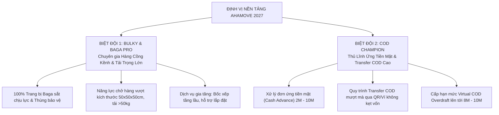
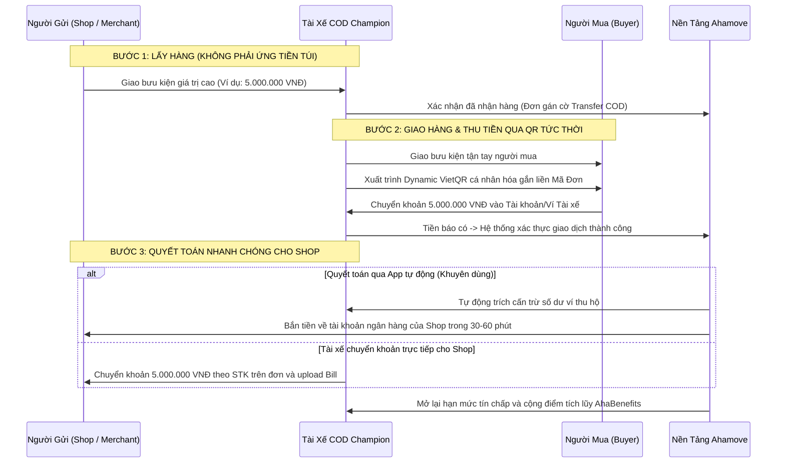
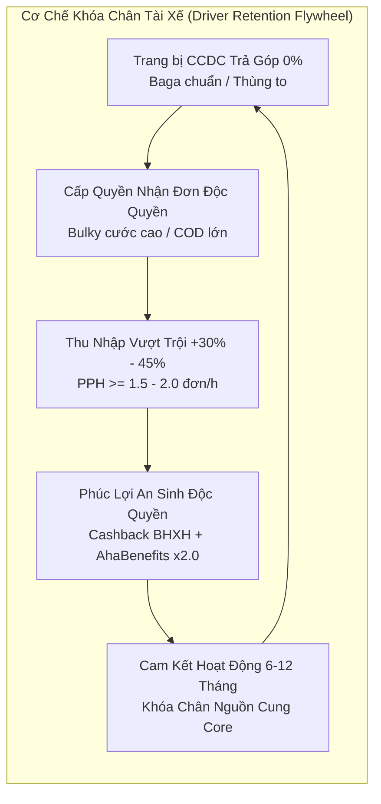
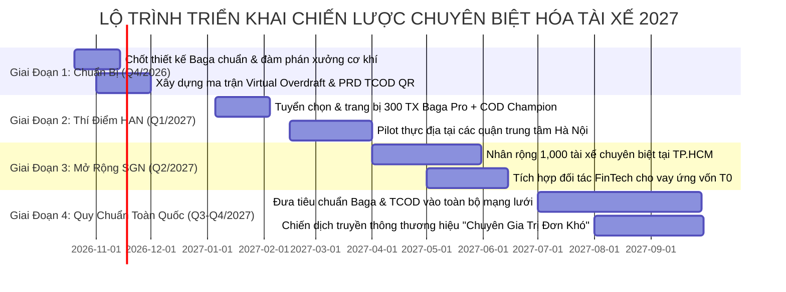

# PLAN STRATEGY 2027: CHUYÊN BIỆT HÓA TÀI XẾ & XÂY DỰNG HÌNH ẢNH THƯƠNG HIỆU VẬN HÀNH AHAMOVE

> **Đơn vị soạn thảo:** Driver Management (DM) & Strategy & Planning (S&P)  
> **Chủ nhiệm đề án:** Lê Phương Khanh (@Lephuongkhanh)  
> **Phiên bản:** v1.0 — Strategic Proposal for 2027  
> **Mục tiêu cốt lõi:** Định hình năng lực cạnh tranh không thể sao chép (Moat) của Ahamove trên thị trường giao nhận xe máy: **Chuyên chở hàng cồng kềnh (Bulky & Baga Pro)** và **Thủ lĩnh xử lý dòng tiền COD (Ứng tiền cao & Transfer COD)**.

---

## 1. TÓM TẮT THỰC THI & ĐỊNH VỊ THƯƠNG HIỆU (EXECUTIVE SUMMARY & BRAND POSITIONING)

### 1.1. Bối Cảnh & Vấn Đề Ngành (Market Context)
* **Bão hòa phân khúc phổ thông (Commoditization of General Bike Delivery):** Dịch vụ giao hàng xe máy cơ bản (giao tài liệu, đồ ăn, bưu kiện nhỏ) tại Việt Nam đã chạm trần tăng trưởng tự nhiên (+17% YoY toàn ngành nhưng biên lợi nhuận bị bào mòn bởi cuộc chiến cắt máu khuyến mãi giữa Grab, Be, Shopee Xpress, Gojek).
* **Nỗi đau khách hàng (Customer Pain Points) chưa ai giải quyết triệt để:**
  1. *Hàng cồng kềnh, tải trọng lớn:* Khách gửi thùng sơn, bao tải hàng thời trang, màn hình tivi, linh kiện điện máy, phụ tùng cơ khí... luôn bị tài xế app khác hủy cuốc vì "không chở được", "sợ gãy đuôi xe", "không có đồ chằng buộc".
  2. *Đơn hàng giá trị cao kẹt dòng tiền COD:* Các đơn hàng cần ứng tiền mặt từ 2 triệu đến 10 triệu hoặc đơn yêu cầu người mua chuyển khoản (Transfer COD) với số tiền lớn thường xuyên bị trôi dạt (FR đơn >3M tại Hà Nội từng rơi chạm đáy 2.3% – 24.8%) do tài xế thiếu vốn lưu động và nền tảng thiếu cơ chế bảo lãnh tài chính.

### 1.2. Định Vị Thương Hiệu 2027: "Ahamove — Chuyên Gia Trị Đơn Khó"
Khi khách hàng (Merchant, Chủ shop online, KA, Khách lẻ) nghĩ tới Ahamove, định vị trong tâm trí (Top-of-Mind) phải là:

$$\mathbf{Ahamove} = \mathbf{Vua\ Hàng\ Cồng\ Kềnh\ (Bulky\ Baga\ Pro)} + \mathbf{Thủ\ Lĩnh\ Dòng\ Tiền\ COD\ (Ứng\ Cao\ \&\ Transfer\ COD)}$$

---

## 2. CHIẾN LƯỢC XÂY DỰNG 2 BIỆT ĐỘI NÒNG CỐT (THE TWIN SPECIALIZED FLEETS)

### 2.1. BIỆT ĐỘI 1: BULKY & BAGA PRO (VUA HÀNG CỒNG KỀNH & AN TOÀN)

#### A. Tiêu Chuẩn Nhận Diện & Trang Thiết Bị CCDC
Khách hàng nhìn vào tài xế Ahamove Bulky là nhận diện được sự chuyên nghiệp và an tâm tuyệt đối:
* **Baga sắt công nghiệp chuẩn hóa (Standardized Heavy-duty Baga):** Baga chịu lực tải trọng 70kg–100kg, có gờ chắn trượt, móc kéo dây chun đa điểm, thiết kế gấp mở linh hoạt không gây hư hại yên xe.
* **Bộ dây chằng chuyên dụng & Lưới bọc hàng:** 100% trang bị dây dù có khóa siết tăng đơ (ratchet tie-down strap) và lưới bọc co giãn chống rơi rớt.
* **Màng bọc màng PE & Xốp chống sốc dự phòng:** Tài xế được cấp cuộn màng PE Ahamove để quấn bảo vệ hàng khi gặp trời mưa hoặc hàng dễ trầy xước.
* **Option Thùng giữ form / Thùng gấp:** Dành cho nhóm chuyên chở linh kiện điện tử, thùng carton dễ móp méo.

#### B. Cơ Chế Đầu Tư CCDC: Tài Trợ Kết Hợp Trả Góp 0% Gắn Ràng Buộc
Nhằm giải quyết bài toán tài xế ngại bỏ tiền túi trang bị Baga (giá 350.000 – 600.000 VNĐ):
* **Ahamove tài trợ 40% chi phí:** Công ty đặt hàng sản xuất số lượng lớn với xưởng cơ khí theo quy chuẩn Ahamove (tiết kiệm 30% giá thị trường).
* **60% còn lại cho trả góp 0%:** Khấu trừ tự động vào thu nhập tuần của tài xế (mỗi tuần trích 30.000 – 50.000 VNĐ trong 8–10 tuần).
* **Cam kết gắn kết:** Tài xế ký cam kết duy trì hoạt động tối thiểu 6 tháng và nhận tỷ trọng đơn Bulky ≥ 40%. Nếu đạt DQS ≥ 4.85 và sản lượng yêu cầu sau 6 tháng, Ahamove hoàn lại 100% số tiền tài xế đã trả góp (Biến Baga thành phần thưởng thâm niên miễn phí).

#### C. Quy Chế Vận Hành & Dispatching Ưu Tiên
* **Gán nhãn chuyên biệt (Skill Tag: `PRO_BULKY`):** Thuật toán ưu tiên độc quyền các đơn hàng có phụ phí hàng cồng kềnh, cước xe lớn cho tài xế có tag này.
* **Dịch vụ gia tăng tích hợp trên App:**
  * Option *Kèm người bốc xếp tầng lầu* (+30k–50k/chuyến).
  * Option *Hỗ trợ cắm điện / Lắp đặt đồ cơ bản* (+50k–100k/chuyến).
  * Tài xế hưởng 85% – 90% doanh thu phụ phí này.

---

### 2.2. BIỆT ĐỘI 2: COD CHAMPION (THỦ LĨNH ỨNG TIỀN MẶT & TRANSFER COD CAO)

#### A. Định Nghĩa & Tối Ưu Quy Trình Vận Hành Transfer COD (TCOD)
Dựa trên cơ chế thực tế của Ahamove: **"Người mua chuyển khoản vào tài khoản/ví của tài xế, sau đó tài xế chuyển về cho Shop/Ahamove"**:

#### B. Khắc Phục Điểm Nghẽn Đơn Ứng Tiền Mặt Lớn (Cash Advance) Bằng Virtual COD Overdraft
Với các đơn hàng mà Shop bắt buộc ứng tiền mặt trước tại điểm gửi:
* Thay vì bắt tài xế nộp 100% cọc tiền mặt, cấp **Hạn mức Tín chấp Ký quỹ Ảo (Virtual COD Overdraft)**:
  * **Hạng Bán Chuyên (BC):** Cấp thêm `+500.000 VNĐ` (nhận đơn tới 1.5M).
  * **Hạng Chuyên Nghiệp (CN):** Cấp thêm `+1.500.000 VNĐ` (nhận đơn tới 3.0M).
  * **Hạng Siêu Cấp (SC Elite):** Cấp thêm `+3.000.000 VNĐ` (nhận đơn tới 5.0M).
  * **Tài xế Biệt Đội Chuyên Biệt COD:** Cấp thêm `+8.000.000 VNĐ` (nhận đơn tới **10.000.000 VNĐ**).
* **Giải pháp ứng vốn T0 trong ngày (FinTech Partner):** Tài xế có thể bấm nút "Ứng vốn COD siêu tốc" ngay trên đơn hàng, đối tác tài chính giải ngân tạm thời vào ví tài xế trong 2 phút với mức phí cố định siêu rẻ **5.000 – 12.000 VNĐ/cuốc**.

#### C. Bộ Khung Kiểm Soát Rủi Ro & Chống Thất Thoát (Risk Management)
* **Xác thực sinh trắc học & CCCD gắn chip (eKYC Level 2):** Chỉ những tài xế có hồ sơ định danh chuẩn, có giấy xác nhận cư trú hoặc hợp đồng fleet mới được vào Biệt Đội COD Champion.
* **Đồng hồ đếm ngược 120 phút (Cut-off Rule):** Tài xế có tối đa 120 phút sau khi người mua chuyển tiền để hoàn tất nghĩa vụ quyết toán với Shop/Ahamove. Quá 120 phút: Tự động khóa tính năng nhận đơn và kích hoạt tổng đài nhắc nhở.
* **Cơ chế thu hồi tự động (Auto-deduction):** Tự động cấn trừ vào tiền thưởng tuần, tiền tip, và doanh thu các cuốc xe tiếp theo.
* **Quỹ bảo hiểm thất thoát COD (0.5% – 0.8% phí dịch vụ):** Đảm bảo an toàn tài chính tuyệt đối cho Shop ngay cả khi xảy ra sự cố hy hữu.

---

## 3. CƠ CẤU PHÂN TẦNG VẬN HÀNH & KINH TẾ HỌC TÀI XẾ (UNIT ECONOMICS & RETENTION)

### 3.1. So Sánh Thu Nhập Giữa Tài Xế Thường vs Tài Xế Chuyên Biệt

| Hạng Mục So Sánh | Tài Xế Phổ Thông (Mass Driver) | Tài Xế Chuyên Biệt (Bulky & COD Champion) | Chênh Lệch / Lợi Thế (Delta) |
| :--- | :--- | :--- | :--- |
| **Giá Trị Đơn Trung Bình** | 20.000 – 35.000 VNĐ / đơn | **45.000 – 95.000 VNĐ / đơn** (Có phụ phí hàng to & COD) | **Cao hơn gấp 2.0 – 2.5 lần** |
| **PPH (Đơn/giờ) & Doanh thu ca 8h** | 1.0 – 1.2 đơn/h (~250k – 320k/ngày) | **1.5 – 2.0 đơn/h (~450k – 650k/ngày)** | **Thu nhập tăng +40% đến +60%** |
| **Hệ Số Nhân Điểm AhaBenefits** | Hệ số cơ bản $\times 1.0$ | **Nhân đôi $\times 1.5 – \times 2.0$ khi chạy trong Zone** | Tích điểm đổi quà, voucher bảo dưỡng xe nhanh gấp đôi |
| **Gói An Sinh Xã Hội** | Không có (Tự do) | **Ahamove Cashback đóng BHXH tự nguyện** (cho FT Elite) | Tạo rào cản chuyển đổi sang Grab/Be cực lớn |
| **Tỷ Lệ Rời Bỏ (Quarterly Churn)** | 25% – 35% / quý | **Dưới 8% / quý** (Đội nòng cốt ổn định) | Giảm chi phí tuyển dụng mới (CPA) của công ty |

---

## 4. HIỆN THỰC HÓA GIÁ TRỊ & KẾ HOẠCH HÀNH ĐỘNG (VALUE REALIZATION & ROADMAP)

### 4.1. Bảng Chuyển Đổi Vận Hành (BEFORE → AFTER)

| Chiều Không Gian | Hiện Trạng (As-Is 2026) | Trạng Thái Mục Tiêu (Target State 2027) | Tác Động Kinh Doanh Đo Lường Được |
| :--- | :--- | :--- | :--- |
| **Hình Ảnh Đội Ngũ** | Tài xế tự do, xe cộ manh mún, không có chuẩn Baga, khách sợ giao hàng to. | Biệt đội Baga Pro đồng bộ, logo phản quang, dây chằng chuẩn công nghiệp. | **Tăng 45% lượng đơn hàng cồng kềnh SME/KA đặt qua app** |
| **Xử Lý Đơn COD Lớn** | Thiếu tài xế có cọc tiền tươi, FR đơn >3M chỉ đạt 23%–33%, khách kêu ca. | Biệt đội COD Champion vận hành luồng TCOD qua QR tức thời + Virtual Overdraft. | **Kéo FR đơn COD >3M từ 24% lên ≥ 55% – 60%** |
| **Dòng Tiền Đối Soát** | Phân mảnh qua Zalo/chuyển khoản ngoài app, nguy cơ gian lận và khiếu nại. | 100% luồng Transfer COD chuẩn hóa qua Dynamic QR trên app, đối soát tự động. | **Giảm 90% khiếu nại COD & Triệt tiêu rủi ro nợ xấu** |
| **Doanh Thu Gia Tăng** | Chỉ thu cước cơ bản của chuyến xe. | Thu phụ phí hàng cồng kềnh, phí bốc xếp lầu, và phí tiện ích ứng tiền T0. | **Tăng Take-rate toàn sàn thêm +2.5% – 3.8%** |

---

### 4.2. Lộ Trình Triển Khai 4 Giai Đoạn (Execution Roadmap)

---

### 4.3. Ma Trận Phân Công Trách Nhiệm (RACI Matrix)

| Hạng Mục Chiến Lược | Driver Management (Khanh) | Product & Tech (QM) | Business Development (KA) | Marketing & Brand | Legal & Compliance |
| :--- | :---: | :---: | :---: | :---: | :---: |
| **Thiết kế & đặt hàng Baga chuẩn** | **Accountable (Chịu trách nhiệm chính)** | Consulted | Informed | Informed | Consulted |
| **Thuật toán Dispatch & Virtual Overdraft** | Responsible | **Accountable (QM)** | Informed | Informed | Consulted |
| **Tính năng Dynamic VietQR cho Transfer COD**| Responsible | **Accountable (Tech Lead)** | Consulted | Informed | Informed |
| **Chính sách hỗ trợ tài trợ & trả góp CCDC** | **Accountable (Khanh)** | Informed | Consulted | Informed | Responsible |
| **Truyền thông định vị "Chuyên Trị Đơn Khó"** | Consulted | Informed | Responsible | **Accountable** | Informed |
| **Hợp tác đối tác FinTech (Ứng vốn T0)** | Responsible | Consulted | **Accountable** | Informed | Responsible |
