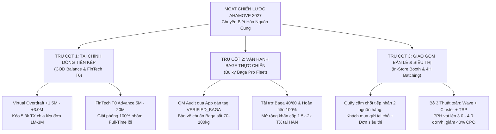
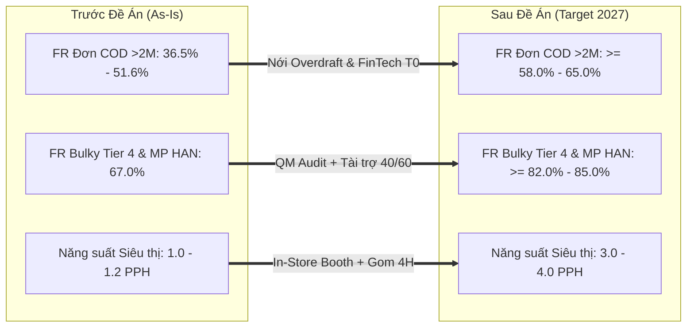
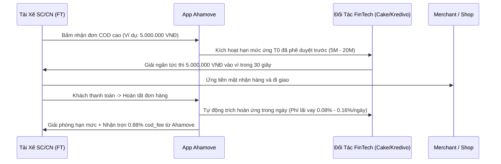
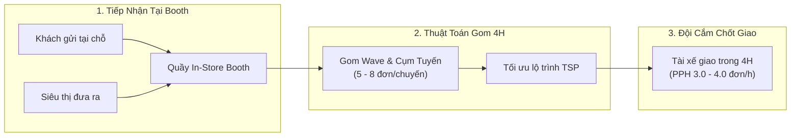
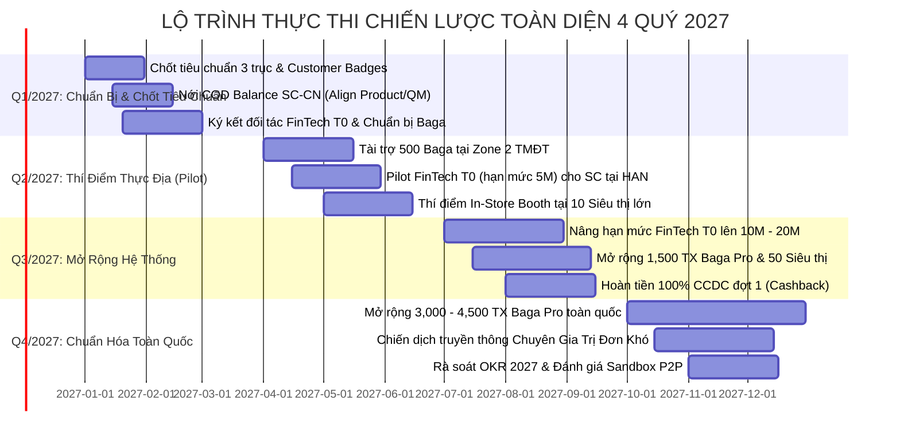

# 📋 ĐỀ ÁN CHIẾN LƯỢC 2027: CHUYÊN BIỆT HÓA TÀI XẾ & XÂY DỰNG MOAT VẬN HÀNH ĐỘC QUYỀN
## TỐI ƯU HÓA DÒNG TIỀN COD (ORDER COD & DRIVER BALANCE) — BIỆT ĐỘI BULKY BAGA PRO — IN-STORE BOOTH & GIAO GOM SIÊU THỊ 4H

> **Tài liệu chiến lược lưu hành nội bộ (Ahamove Enterprise Strategy)**  
> **Đơn vị chủ trì:** Khối Quản trị Vận hành & Nguồn cung (Driver Management - DM) & Ban Chiến lược (Strategy & Planning - S&P)  
> **Chủ nhiệm đề án:** Lê Phương Khanh (@Lephuongkhanh) — Driver Management Leader  
> **Kính gửi:** Ban Giám Đốc (BOD) & Head of Product (Anh Quang Minh - QM)  
> **Phiên bản:** v6.2 Enterprise Lark Docs Edition (Tháng 10/2026)  
> **Hệ thống dữ liệu nền tảng (Lũy kế 10 tháng T1 – T10/2026):**  
> 1. `cod block.xlsx`: 34.66 triệu đơn phân theo 5 block Tiền ứng COD & 26.01 triệu đơn phân bổ theo FT/PT/New.  
> 2. `cod_balance.xlsx`: 3.82 triệu lượt phân tầng hạn mức ví & phân bổ số dư của 27,113 tài xế active.  
> 3. `bulky.xlsx` & Dữ liệu Nguồn cung thực tế: 5.47 triệu đơn cồng kềnh (2.85 triệu đơn bắt buộc Baga mang lại 127.5 Tỷ thu nhập) và diễn biến 12,727 tài xế active chạy Tier 4 & MP.

---

## 1. 📊 TÓM TẮT THỰC THI (EXECUTIVE SUMMARY)

### 1.1. Luận Điểm Kim Tự Tháp (The Pyramid Principle)
Ahamove không cạnh tranh giá rẻ dàn trải trong phân khúc giao hàng phổ thông vốn đã bị bào mòn bởi cuộc chiến đốt tiền promo. Chiến lược cốt lõi 2027 là **Chuyên biệt hóa Nguồn cung (Driver Specialization)** để làm chủ **"Phân khúc Đơn Khó"** — nơi rào cản vận hành cao nhất và đối thủ không thể giải quyết bằng công nghệ thuần túy:

1. **Hiển thị năng lực thực tế thành Moat trên App khách (Customer-Facing Badges):** Gán huy hiệu chuyên môn hóa (`PRO_BULKY`, `COD_CHAMPION`) giúp khách hàng doanh nghiệp (SME/KA/TMĐT) an tâm tuyệt đối, triệt tiêu 100% tình trạng hủy đơn do tài xế không đủ tiền ứng hoặc xe không chở được hàng to.
2. **Giải phóng dứt điểm 2 bài toán Dòng tiền COD:**
   * *Mặt 1 (Order COD):* Giải quyết điểm nghẽn tiền ứng túi tài xế ở block $\ge 500k$ và $>1M – \ge 5M$.
   * *Mặt 2 (Driver COD Balance):* Xóa bỏ "vực thẳm 1M–3M" và cơ chế giam hạn mức tức thời bằng **Virtual Overdraft (+1.5M đến +3.0M)** và **Tín dụng FinTech T0 trong ngày (5M–20M)**.
3. **Chuẩn hóa & Tái cấu trúc Biệt đội Bulky Baga Pro:** Xử lý triệt để đà suy giảm -29.8% nguồn cung tài xế cồng kềnh; phối hợp QM audit hình ảnh thực tế qua App để cấp chứng nhận và mở rộng khẩn cấp 1,500 – 2,000 tài xế Baga tại Hà Nội qua chính sách tài trợ 40/60.
4. **Mô hình In-Store Service Booth & Fleet Giao Gom Siêu Thị 4H:** Đặt quầy cắm chốt tại các chuỗi bán lẻ lớn, không làm khâu nhặt hàng online mà tiếp nhận trực tiếp hàng khách gửi tại chỗ và đơn siêu thị đẩy ra; ứng dụng bộ 3 thuật toán gom đợt sóng (Wave), phân cụm (Cluster) và tối ưu lộ trình (TSP) để giao hàng trong 4 tiếng với năng suất vượt trội.

---

### 1.2. Mục Tiêu Kinh Doanh Theo Khung S-C-R (Situation - Complication - Resolution)

* **Bối Cảnh (Situation):**  
  Ahamove sở hữu mạng lưới logistics xe máy hàng đầu với hơn 34.66 triệu đơn hàng, trong đó nhóm đơn cồng kềnh (Bulky Tiers) đóng góp 5.47 triệu đơn và 237.4 Tỷ VNĐ thu nhập cho đối tác. Lực lượng tài xế Full-time thâm niên (SC/CN) là xương sống gánh vác 53%–58% các đơn hàng COD lớn.

* **Thách Thức / Khủng Hoảng (Complication):**  
  1. *Khủng hoảng đơn COD lớn:* Tỷ lệ hoàn thành (FR) rơi tự do từ 76.3% (đơn <500k) xuống đáy 36.5% – 51.6% (đơn hạn mức >2M), thất thoát ước tính ~165 Tỷ VNĐ GMV/tháng. Hơn 53.5% tài xế (14,260 người) có balance $\le 1M$ bị "đóng băng" không thể nhận đơn 1.5M–2M; trong khi nhóm 10,480 tài xế $>3M$ bị giam hạn mức tức thời (Dynamic Capacity Lock).
  2. *Báo động suy giảm nguồn cung Bulky Thật:* Lực lượng tài xế thực chiến nhận đơn cồng kềnh Tier 4 & MP (`bulky_real_active`) sụt giảm -29.8% toàn sàn (từ 18,140 xuống 12,727 TX). Riêng tại Hà Nội, số tài xế chạy hàng khó rơi từ 5,633 xuống 4,054 TX khiến FR Tier 4 & MP tại Hà Nội chạm đáy thảm hại **67%** (chỉ 51% tài xế tự tick baga thực tế có chạy).
  3. *Mảng siêu thị lãng phí công suất:* Giao hàng 1:1 siêu tốc khiến chi phí CPO cao, tài xế chỉ đạt 1.0–1.2 đơn/giờ, không phục vụ được khách mua trực tiếp tại quầy có nhu cầu gửi hàng về nhà.

* **Giải Pháp Đột Phá (Resolution):**  
  Triển khai đồng bộ 3 Trụ cột Chuyên biệt hóa: (1) Virtual Overdraft & Tín dụng T0 FinTech cho 7,500–8,000 tài xế Full-time; (2) QM Audit qua App xác minh Baga sắt chuẩn, kết hợp tài trợ 40/60 mở rộng 1,500–2,000 Baga tại HAN; (3) In-Store Service Booth cắm chốt tại các chuỗi siêu thị giao gom đa điểm 4 tiếng.

---

### 1.3. Bộ Chỉ Số Cốt Lõi (Core Enterprise KPIs)

| Nhóm Chỉ Số | Tên Chỉ Số Cụ Thể | Hiện Trạng (As-Is 10/2026) | Mục Tiêu Chiến Lược 2027 | Tác Động Kinh Doanh Dự Phóng |
| :--- | :--- | :---: | :---: | :--- |
| **Dòng Tiền COD** | **FR Đơn COD Hạn Mức > 2M** | **36.5% – 51.6%** | **$\ge$ 58.0% – 65.0%** | **Thu hồi +35 – 45 Tỷ VNĐ GMV thất thoát/tháng** |
| | **Nguồn Cung Tài Xế Nhận Đơn > 1M** | 10,480 TX (bị giam ví) | **15,800 TX (+51%)** | Thêm 5,397 TX nhóm 500k–1M tham gia chia lửa |
| | **Tỷ Lệ Hủy Đơn Do Thiếu Tiền Ứng (CR_COD)** | 18.5% | **$\le$ 3.5%** | Giảm thiểu khiếu nại và trải nghiệm tiêu cực của Shop |
| **Bulky Baga Pro** | **FR Nhóm Cần Baga (Tier 4 & MP)** | **67.0% (HAN) / 74.5% (Sàn)** | **$\ge$ 82.0% – 85.0%** | Xử lý trọn vẹn 2.85 triệu đơn cồng kềnh khó nhất |
| | **Pool Tài Xế Verified Baga Chuẩn** | Chưa xác minh (tự tick 17.4k) | **3,500 – 4,500 TX Verified** | Đảm bảo 2,100 TX hoạt động/ngày gánh 9.5k đơn |
| | **Tỷ Lệ Hư Hại Hàng Cồng Kềnh** | 1.5% – 2.0% | **$\le$ 0.3%** | Nhờ khung Baga chịu lực 70–100kg & dây tăng đơ |
| **Siêu Thị & Bán Lẻ** | **Năng Suất Giao Hàng (PPH)** | 1.0 – 1.2 đơn/giờ | **3.0 – 4.0 đơn/giờ (+250%)** | Giao gom 5 – 8 đơn/chuyến theo đợt sóng 4 tiếng |
| | **Chi Phí Giao Trên Đơn (CPO)** | Baseline 100% | **Giảm 35% – 45%** | Tiết kiệm chi phí vận chuyển, hạ giá cước cho khách |
| | **Tỷ Lệ Lấp Đầy Tải Xe (Load Factor)** | 40% – 50% | **85% – 90%** | Tối đa hóa hiệu suất thùng hàng và baga xe máy |

---

## 2. 🔬 KHUNG PHÂN TÍCH CHIẾN LƯỢC (STRATEGIC ANALYSIS FRAMEWORK)

---

### 2.1. Phân Tích Mô Tả (Descriptive Analysis — Đánh Giá Hiện Trạng)

#### A. Hạ Tầng Vận Hành Hiện Tại
* **Cơ chế Dispatch COD:** Kiểm soát cứng ngắc bằng công thức $\mathbf{Khả\ năng\ nhận\ đơn\ hiệu\ dụng} = \mathbf{max(COD\ Balance,\ Deposit)}$. Tài xế bắt buộc phải có tiền mặt ký quỹ tương ứng với 100% giá trị đơn hàng, triệt tiêu động lực nhận đơn lớn.
* **Cơ chế Nhận Hàng Cồng Kềnh:** Hoàn toàn dựa vào nút tự tick "Tôi có Baga" trên ứng dụng tài xế mà **không có bất kỳ cơ chế kiểm duyệt nào từ QM**. 17,422 tài xế tick có Baga nhưng khi nổ cuốc cồng kềnh thật sự thì hủy đơn hoặc từ chối nhận vì chỉ gắn baga nhựa/baga yếu.
* **Mảng Siêu Thị:** Vận hành phân mảnh theo đơn lẻ 1 tài xế nhận 1 đơn giao ngay; chưa có điểm tiếp nhận cố định tại quầy cho khách mua trực tiếp.

#### B. Thống Kê Phân Tầng Dữ Liệu Thực Tế Lũy Kế 10 Tháng 2026

##### ① Dữ liệu Đơn Hàng Có Tiền Ứng COD (`cod block.xlsx` — 34.66M Đơn):
* **Block < 500k:** Chiếm 87.84% tổng đơn (30.45M đơn), FR đạt mức chuẩn **76.28%** với 14,975 tài xế active nhận đơn/tháng.
* **Block < 1M:** Chiếm 7.06% (2.45M đơn), FR sụt xuống **67.06%**, mất 39.6% nguồn cung (còn 9,051 TX).
* **Block < 3M:** Chiếm 4.39% (1.52M đơn), FR đạt **64.31%**, chỉ còn 6,640 TX tham gia.
* **Block < 5M:** Chiếm 0.54% (188k đơn), FR rơi xuống **62.24%** (riêng HAN chỉ đạt 58.4%), nguồn cung co thắt -84.4% (còn 2,333 TX).
* **Block >= 5M:** Chiếm 0.16% (56.5k đơn), FR đạt **63.64%**, chỉ còn vỏn vẹn **935 tài xế/tháng** gánh đơn (mất -93.8% tài xế).
* **Trụ cột Full-Time (FT):** Nhóm FT đóng góp tới **53.14%** số đơn hoàn thành ở block $\ge 5M$ (SGN đạt 58.17%), trong khi tài xế mới (New) chỉ gánh 0.66%.

##### ② Dữ liệu Hạn Mức COD Balance Của Tài Xế (`cod_balance.xlsx` — 3.82M Lượt & 26.68k Tài Xế):
* **Sự phân hóa số dư:** 53.5% tài xế toàn sàn (14,260 người) có balance $\le 1M$ (HAN chiếm 62.6%, SGN chiếm 44.5%).
* **Nhóm số dư lớn > 3M:** Có tới **10,480 tài xế** (SGN: 6,019 TX chiếm 44.7%; HAN: 4,379 TX chiếm 33.1%).
* **Điểm gãy FR theo hạn mức:** Block hạn mức 500k đạt đỉnh FR **60.80%** (AR 78.5%), nhưng đến block 2M giảm xuống **51.60%**, block 4M còn **44.54%**, và block 10M rơi chạm đáy **36.56%** (chỉ 1/3 đơn thành công).

##### ③ Dữ liệu Hàng Cồng Kềnh (`bulky.xlsx` — 5.47M Đơn):
* **Nhóm đơn bắt buộc có Baga (Tier 4 & MP Bulky):** Phát sinh **2,849,494 đơn** (chiếm 52.05% tổng đơn cồng kềnh và 8.22% đơn toàn sàn), đóng góp **127.47 Tỷ VNĐ thu nhập** cho tài xế.
* Tier 4 (Cồng kềnh nặng): 1,073,976 đơn, FR đạt 75.24%, thu nhập tài xế 62.89 Tỷ VNĐ.
* MP Bulky (Hàng sàn TMĐT): 1,775,518 đơn, FR đạt 74.17%, thu nhập tài xế 64.58 Tỷ VNĐ.

##### ④ Dữ liệu Diễn Biến Nguồn Cung Baga & Bulky Thật Năm 2026:

| Tháng | Thành Phố | Tick Baga (`baga_active`) | Chạy Bulky Mọi Tier (`bulky_active`) | **Active Bulky Thật: Tier 4 & MP (`bulky_real_active`)** | Tỷ Lệ MP & Tier 4 / Tick Baga | Đơn Xong (`bulky_stp`) | Tổng Sàn Real Bulky (`total_real`) |
| :---: | :---: | :---: | :---: | :---: | :---: | :---: | :---: |
| **10/2026** | **SGN** | 9,479 | 8,212 | **6,570** | **69.3%** | 172,554 | 12,727 |
| **10/2026** | **HAN** | 7,943 | 6,491 | **4,054** | **51.0%** | 105,279 | 12,727 |
| **10/2026** | **TOÀN MẠNG** | **17,422** | **21,612 (sàn)** | **12,727** | **73.1%** | **277,833** | **12,727** |
| **09/2026** | SGN / HAN | 10,773 / 8,787 | 9,287 / 7,241 | 7,417 / 4,598 | 68.8% / 52.3% | 265,404 / 149,580 | 14,889 |
| **08/2026** | SGN / HAN | 11,065 / 8,778 | 9,592 / 7,319 | 7,544 / 4,599 | 68.2% / 52.4% | 286,305 / 153,877 | 14,514 |
| **07/2026** | SGN / HAN | 11,263 / 9,027 | 9,728 / 7,385 | 7,634 / 4,366 | 67.8% / 48.4% | 271,353 / 137,021 | 14,267 |
| **03/2026** | SGN / HAN | 10,320 / 9,085 | 9,131 / 7,364 | **7,997 / 5,633** | 77.5% / 62.0% | 260,192 / 131,384 | 17,140 |
| **01/2026** | SGN / HAN | 9,379 / 8,317 | 8,569 / 7,041 | **7,639 / 5,532** | 81.4% / 66.5% | 248,940 / 139,283 | 18,140 |

---

### 2.2. Phân Tích Chẩn Đoán (Diagnostic Analysis — Điều Tra Nguyên Nhân Gốc Rễ)

#### A. Khoảng Trống Chất Lượng (Quality Gaps) — "Ảo Ảnh Tự Tick"
* Con số 17,422 tài xế tick có Baga tạo ra một **ảo tưởng nguồn cung lớn** trên dashboard điều hành. Thực tế, khi bóc tách nhóm chạy đơn Tier 4 và MP Bulky thật sự, toàn sàn chỉ còn **12,727 tài xế**.
* Tại Hà Nội, có tới **49.0% tài xế tick Baga nhưng không hề chạy đơn Tier 4 & MP**. Sự bất cân xứng thông tin giữa việc tài xế khai báo và năng lực thực tế khiến hệ thống dispatch phát cuốc sai đối tượng, dẫn đến chuỗi từ chối nhận đơn liên hoàn và làm sụp đổ FR.

#### B. Điểm Nghẽn Vận Hành (Operational Bottlenecks)
1. **Hiệu ứng giam hạn mức tức thời (Dynamic Capacity Lock):**  
   Nhóm 10,480 tài xế $>3M$ hoàn toàn đủ điều kiện bao bọc (cover) các đơn 1M–3M. Tuy nhiên, khi 1 tài xế nhận 1 đơn 2.5M, hạn mức khả dụng của họ bị trừ ngay xuống chờ giao và nộp lại thành công. Họ bị "khóa cứng" trong 60–120 phút di chuyển và giao hàng, không thể nhận thêm bất kỳ đơn lớn nào khác phát sinh trong khung giờ cao điểm.
2. **Khối tài xế $\le 1M$ bị cô lập:**  
   14,595 tài xế (53.8%) bị kẹt ở mức balance $\le 1M$ vì không có sẵn tiền mặt ký quỹ, trở thành lực lượng "đứng ngoài cuộc" không thể chia lửa cho nhóm $>3M$.
3. **Đà suy giảm nguồn cung Bulky Thật (-29.8%):**  
   Toàn mạng đã mất đi **5,413 tài xế chuyên chở cồng kềnh** (từ 18,140 TX T1 xuống 12,727 TX T10). Riêng tại Hà Nội, số tài xế chạy hàng khó giảm từ 5,633 xuống 4,054 TX (-28.0%). Do không có chính sách trang bị CCDC chuẩn và cơ chế bù đắp hao mòn phương tiện, tài xế nản lòng và từ bỏ chở hàng to $\rightarrow$ **FR Tier 4 tại HAN rơi xuống 67.09% và MP rơi xuống 67.88%**.

#### C. Lệch Pha Chiến Lược (Misalignments)
* **Xung đột giữa tăng trưởng GMV và rủi ro tín dụng:** Bộ phận Kinh doanh muốn đẩy mạnh đơn giá trị cao và đơn KA TMĐT, nhưng hệ thống Product/Risk lại áp đặt hạn mức cọc tiền mặt 100% để phòng ngừa quỵt tiền. Sự thiếu vắng giải pháp FinTech trung gian đã biến rủi ro tín dụng thành rào cản bóp nghẹt tăng trưởng.

---

### 2.3. Phân Tích Dự Báo (Predictive Analysis — Mô Hình Hóa Tương Lai)

#### A. Dự Phóng Kết Quả (Outcome Projections)

#### B. Định Lượng Tác Động Kinh Doanh (Impact Modeling)
1. **Thu hồi GMV Đơn COD lớn:** Nâng FR đơn hạn mức $>2M$ từ 36.5%–51.6% lên $\ge 58\% - 65\%$ giúp giải cứu **+35 đến +45 Tỷ VNĐ GMV thất thoát mỗi tháng**, tạo ra thêm **450 – 600 triệu VNĐ Take-rate ròng/tháng** cho Ahamove.
2. **Bảo vệ thị phần đơn TMĐT cồng kềnh:** Đưa FR Tier 4 & MP tại Hà Nội từ 67% lên $\ge 82\%$ giúp hoàn thành thêm **18,000 – 22,000 đơn hàng cồng kềnh/tháng**, ngăn chặn tình trạng các sàn Shopee/Lazada/TikTok Shop chuyển luồng sang đối thủ xe tải hoặc bên thứ ba.
3. **Hiệu ứng vòng đời tài xế (Driver Retention & LTV):** Tài xế Baga Pro có thu nhập ổn định cao hơn 25%–35% so với tài xế chạy hàng thông thường, giảm tỷ lệ rời bỏ (Churn rate) của nhóm Full-time từ 14%/tháng xuống $<5\%$/tháng.

---

### 2.4. Phân Tích Đề Xuất (Prescriptive Analysis — Khuyến Nghị Chiến Lược)

---

#### TRỤ CỘT 1: GIẢI PHÁP TÀI CHÍNH KÉP — NỚI COD BALANCE & FINTECH T0 ADVANCE

##### 1. Cơ Chế Tín Chấp 2 Tầng Cho 7,500 – 8,000 Tài Xế Full-Time (SC/CN):
* **Tầng 1 — Virtual Overdraft Nội Bộ (+1.5M đến +3.0M):**  
  Cấp hạn mức tín chấp hiển thị trên balance cho tài xế hạng Siêu Cấp (SC) và Chuyên Nghiệp (CN) có DQS $\ge 4.85$ và không có lịch sử gian lận trong 3 tháng gần nhất. Giải pháp kéo ngay lập tức **hơn 5,397 tài xế đang bị giam ở block 500k–1M** lên ngưỡng sẵn sàng nhận đơn 2M–5M mà không bắt tài xế nộp thêm tiền mặt ký quỹ.
* **Tầng 2 — FinTech T0 Advance Trong Ngày (5M – 20M):**  
  Tích hợp SDK ngân hàng số đối tác (Cake by VPBank / Kredivo) cấp hạn mức ứng vốn tức thời trong 30 giây khi tài xế bấm nhận đơn COD cao.

##### 2. Mô Hình Kinh Tế Win-Win (Win-Win Economics):

* **Lãi vay trong ngày:** 0.08% – 0.16%/ngày (tương đương 4,000 – 8,000 VNĐ trên đơn 5M).
* **Phí ứng COD tài xế nhận:** 0.88% (tương đương 44,000 VNĐ trên đơn 5M).
* $\rightarrow$ **Lãi ròng của tài xế:** Đạt **36,000 – 40,000 VNĐ/đơn** mà không phải bỏ 1 đồng vốn tiền túi.

---

#### TRỤ CỘT 2: BIỆT ĐỘI BULKY BAGA PRO & NÂNG CẤP CÔNG CỤ DỤNG CỤ

##### 1. Tiêu Chuẩn Kỹ Thuật CCDC Baga Pro:
* Baga sắt ống công nghiệp chịu tải trọng $\ge 70 - 100\text{kg}$, có gờ chắn chống trượt hai bên.
* Trang bị đồng bộ bộ dây dù siết tăng đơ (ratchet tie-down strap) và màng PE bọc bảo vệ hàng hóa chống mưa bụi.

##### 2. Quy Trình Xác Minh Baga (QM Verification qua App):
* **Bỏ hoàn toàn bước audit thực địa tại Mini-Hub/Station** để tối ưu tốc độ triển khai và tiết kiệm nguồn lực vận hành.
* **Phương thức thực hiện:** Tài xế chụp ảnh thực tế xe gắn khung Baga sắt đạt chuẩn và tải lên ứng dụng; đội ngũ QM thẩm duyệt hồ sơ và gắn tag `VERIFIED_BAGA` trong vòng **24 giờ**.

##### 3. Đánh Giá Quy Mô Cần Tăng & Kế Hoạch Mở Rộng:
* **Nhu cầu toàn sàn:** ~9,500 đơn Tier 4 & MP Bulky/ngày (SGN: 5,800; HAN: 3,700). Với năng suất 4.5 đơn cồng kềnh/tài xế/ngày, cần **2,100 tài xế hoạt động mỗi ngày** $\rightarrow$ Pool tài xế Verified Baga tối thiểu cần duy trì ổn định là **3,500 – 4,500 tài xế** (SGN: 2,200–3,000; HAN: 1,300–1,500).
* **Chiến lược tại SGN:** 6,570 tài xế đang chạy Tier 4/MP cơ bản đủ nguồn cung sau khi QM audit.
* **Chiến lược tại HAN (Cần mở rộng khẩn cấp):** Nhóm chạy hàng khó tại HAN hiện chỉ có 4,054 TX. Nếu sau khi audit tỷ lệ đạt chuẩn sắt ống chịu lực chỉ khoảng 30%–40% (~1,200 – 1,600 TX), Hà Nội sẽ thiếu hụt trầm trọng. Do đó, Ahamove **BẮT BUỘC PHẢI MỞ RỘNG THÊM 1,500 – 2,000 TÀI XẾ BAGA MỚI TẠI HÀ NỘI**.
* **Chính sách tài trợ Baga 40/60 & Hoàn tiền 100%:**
  * Giá thành: 450,000 VNĐ/bộ Baga chuẩn.
  * Ahamove tài trợ 40% (180,000 VNĐ).
  * Tài xế trả góp 60% (270,000 VNĐ), trừ dần 35,000 VNĐ/tuần trong 8 tuần.
  * **Hoàn tiền 100% (Cashback):** Hoàn lại toàn bộ 270,000 VNĐ sau 6 tháng nếu tài xế đạt KPI tỷ trọng đơn Bulky $\ge 40\%$ và DQS $\ge 4.85$.

---

#### TRỤ CỘT 3: IN-STORE SERVICE BOOTH & FLEET CẮM CHỐT GIAO GOM 4 TIẾNG

##### 1. Mô Hình Vận Hành Tại Quầy Booth Siêu Thị:
Không can thiệp vào khâu nhặt hàng (picker) online, Booth đóng vai trò là Hub tiếp nhận hàng hóa vật lý sẵn có tại điểm bán:
* **Nguồn 1 (Shopper Drop-off):** Khách mua sắm tại chỗ gửi hàng cồng kềnh/nặng (sữa, bia, nước giặt, đồ tươi sống) để thảnh thơi đi chơi/về nhà. Quét bill, dán mã QR trong 30 giây.
* **Nguồn 2 (Store Outbound):** Siêu thị đẩy các đơn bán qua điện thoại, Zalo OA, đơn khách VIP ra quầy theo khung giờ cố định.

##### 2. Bộ 3 Thuật Toán Tối Ưu Năng Suất Giao Gom 4 Tiếng:
1. **Thuật toán Đợt Sóng (Wave-based Cut-off):** Chốt đơn theo 3 khung giờ cố định:
   * *Wave 1 (Sáng):* Chốt đơn lúc **10h00** $\rightarrow$ Xuất phát **10h15**, cam kết giao xong trước **14h00**.
   * *Wave 2 (Chiều):* Chốt đơn lúc **14h00** $\rightarrow$ Xuất phát **14h15**, cam kết giao xong trước **18h00**.
   * *Wave 3 (Tối):* Chốt đơn lúc **17h30** $\rightarrow$ Xuất phát **17h45**, cam kết giao xong trước **21h30**.
2. **Thuật toán Phân Cụm Địa Lý (Spatial Geo-Clustering):** Gom các đơn trong cùng Wave theo cụm trục đường/phường xã (bán kính phát hàng 5–8km), bó thành batch **5 đến 8 đơn/chuyến** cho mỗi tài xế.
3. **Thuật toán Tối Ưu Tuyến Đường (TSP Route Optimization):** Sắp xếp chuỗi điểm dừng theo cung đường tròn khép kín, triệt tiêu quãng đường đi lùi, giảm 35% tổng số km di chuyển của tài xế so với giao tự phát.
* **Định biên & Hiệu quả:** Bố trí 3 – 6 tài xế cắm chốt/siêu thị; đẩy vọt năng suất PPH từ 1.2 lên **3.0 – 4.0 đơn/giờ**, giảm 35%–45% chi phí CPO, lấp đầy 85%–90% tải trọng xe.

---

### 2.5. Bản Đồ Thực Thi 4 Quý Năm 2027 (Execution Roadmap)

---

### 2.6. Ma Trận RACI & Quản Trị Rủi Ro (RACI & Risk Guardrails)

#### A. Ma Trận RACI
| Hạng Mục Chiến Lược | Driver Management (Khanh) | Product & Tech (QM) | Business Development (KA) | Operations (Hubs) | Legal & Compliance |
| :--- | :---: | :---: | :---: | :---: | :---: |
| **1. Chốt 3 trục năng lực & Customer Badges** | **Accountable (A)** | Responsible (R) | Consulted (C) | Informed (I) | Informed (I) |
| **2. Thuật toán Dispatch & Nới COD Balance SC/CN** | Responsible (R) | **Accountable (A - QM)**| Informed (I) | Consulted (C) | Consulted (C) |
| **3. Đàm phán & Tích hợp FinTech Partner T0** | Responsible (R) | Consulted (C) | **Accountable (A)** | Informed (I) | Responsible (R) |
| **4. Xác minh Baga qua App & Tài trợ 40/60** | **Accountable (A)** | Informed (I) | Consulted (C) | Responsible (R) | Consulted (C) |
| **5. Triển khai In-Store Booth & Fleet Gom 4H** | **Accountable (A)** | Responsible (R) | Consulted (C) | Responsible (R) | Consulted (C) |
| **6. Khung quản trị cấn trừ 3 bên & Thu hồi nợ** | Responsible (R) | Responsible (R) | Informed (I) | Informed (I) | **Accountable (A)** |

#### B. Ma Trận Quản Trị Rủi Ro
* **Rủi ro Nợ xấu & Chiếm dụng vốn COD (Mức độ: CAO):** Áp dụng hợp đồng cấn trừ 3 bên tự động; kích hoạt cơ chế đếm ngược 120 phút khóa nhận đơn nếu chưa đối soát; trích lập quỹ dự phòng rủi ro 0.5%–0.8% từ phí cước.
* **Rủi ro Tài xế khai báo Baga ảo (Mức độ: TRUNG BÌNH):** Loại bỏ hoàn toàn khai báo tự tick; QM duyệt ảnh thực tế có kèm biển số xe; thu hồi quyền nhận đơn Tier 4/MP nếu phát hiện vi phạm.
* **Rủi ro Pháp lý đối tác tín dụng (Mức độ: TRUNG BÌNH):** Kết nối song song 2 đối tác FinTech (Cake by VPBank, Kredivo); hiển thị màn hình Explicit Consent theo đúng Nghị định 13/2023/NĐ-CP về bảo vệ dữ liệu cá nhân.

---

## 3. 📈 HIỆN THỰC HÓA GIÁ TRỊ (VALUE REALIZATION)

### Đo Lường Tác Động Kinh Doanh Chuyển Đổi (BEFORE → AFTER)

| Chiều Không Gian Vận Hành | Hiện Trạng (Current State 2026) | Chuyển Đổi Chiến Lược (Transformation) | Trạng Thái Mục Tiêu (Target State 2027) | Tác Động Đo Lường Được (Impact) |
| :--- | :--- | :---: | :--- | :--- |
| **Hiệu Suất Đơn Hàng COD Lớn** | FR đơn COD $>2M$ rơi xuống đáy **36.5% – 51.6%**; mất 93.8% tài xế ở block $\ge 5M$; thất thoát ~165 Tỷ GMV/tháng. | **↓ GIẢI PHÁP TÀI CHÍNH KÉP ↓** | Nới COD Balance theo SC/CN (5M–10M) + Tín dụng T0 FinTech (5M–20M) giải phóng 100% nhóm FT. | ***Kéo FR đơn COD cao lên $\ge$ 58% – 65%; cứu vãn +35–45 Tỷ GMV/tháng.*** |
| **Độ Phủ Tài Xế COD** | 53.8% tài xế (14,595 TX) bị giam ở mức $\le 1M$; nhóm 1M–3M chỉ chiếm 7.5% tạo ra "vực thẳm nguồn cung". | **↓ VIRTUAL OVERDRAFT ↓** | Cấp Virtual Overdraft kéo ngay hơn 5,397 tài xế từ nhóm 500k–1M lên nhóm 1.5M–2.5M. | ***Xóa bỏ vực thẳm 1M–3M, tăng +227% lượng tài xế đủ điều kiện nhận đơn lớn.*** |
| **Năng Lực Hàng Cồng Kềnh** | FR của HAN chỉ đạt **67%** cho thấy lực lượng tx có baga thấp; tỷ lệ hư hại 1.5%–2.0%; nguồn cung thật giảm -29.8%. | **↓ BULKY BAGA PRO & QM AUDIT ↓** | QM Audit qua App + Chuẩn hóa 3,500 – 4,500 tài xế Baga Pro + Mở rộng 1,500–2,000 TX tại HAN. | ***Nâng FR Tier 4 & MP lên $\ge$ 82%–85%; giảm tỷ lệ hư hại xuống <0.3%.*** |
| **Mảng Giao Siêu Thị & Bán Lẻ** | Khách tự chở hàng nặng; siêu thị tự tìm xe lẻ tẻ; CPO cao; PPH chỉ 1.0–1.2 đơn/h; xe chạy rỗng chiều về. | **↓ IN-STORE BOOTH & GIAO GOM 4H ↓** | Quầy Booth cắm chốt + Bộ 3 thuật toán gom đợt sóng 4 tiếng + Fleet giao 5–8 đơn/chuyến. | ***Đẩy vọt PPH lên 3.0 – 4.0 đơn/giờ; giảm 35%–45% CPO; lấp đầy 85%–90% tải xe.*** |
| **Định Vị & Hàng Rào Cạnh Tranh** | Khách chỉ thấy số sao chung chung; cạnh tranh giá rẻ và bị bào mòn bởi promo burn của Grab/Be. | **↓ CUSTOMER-FACING BADGES ↓** | Hiển thị Badge năng lực thực tế: *"Chuyên gia hàng cồng kềnh"*, *"Thủ lĩnh xử lý đơn giá trị cao"*. | ***Định vị độc quyền "Chuyên gia trị đơn khó", tạo Moat vận hành không thể sao chép trong 18 tháng.*** |
