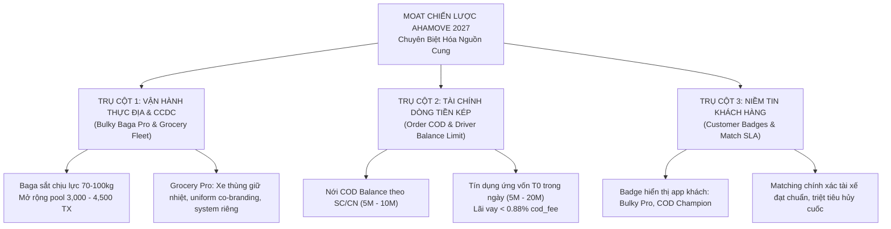
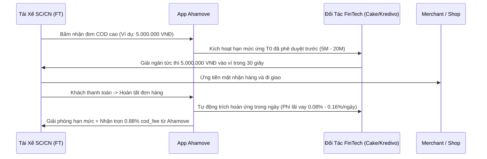
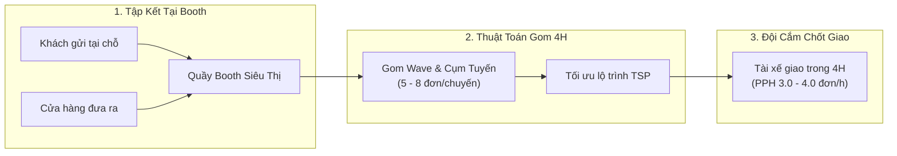
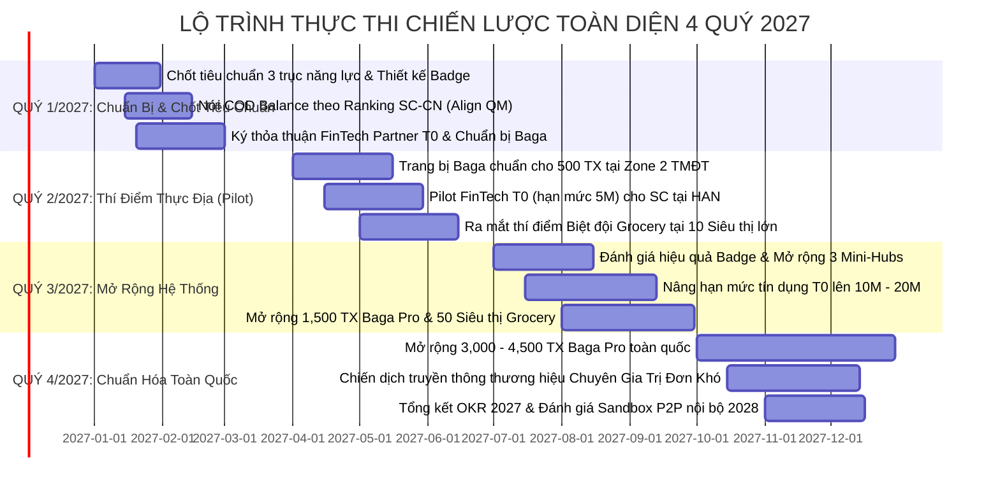

# PLAN STRATEGY 2027: CHUYÊN BIỆT HÓA TÀI XẾ & XÂY DỰNG MOAT VẬN HÀNH TOÀN DIỆN
## (TỐI ƯU HÓA COD BALANCE & FINTECH T0 — BULKY BAGA PRO — ĐỘI CẮM CHỐT GROCERY FLEET)

> **Đơn vị soạn thảo:** Driver Management (DM) & Strategy & Planning (S&P)  
> **Chủ nhiệm đề án:** Lê Phương Khanh (@Lephuongkhanh) — Driver Management Leader  
> **Kính gửi:** Ban Giám Đốc (BOD) & Head of Product (Anh Quang Minh - QM)  
> **Phiên bản:** v6.0 Master Enterprise Strategy (Oct 2026) — Complete & Distinct Edition  
> **Tách bạch 2 hệ thống dữ liệu cốt lõi (10 tháng lũy kế T1 – T10/2026):**  
> 1. `cod block.xlsx`: Dữ liệu **Tiền Ứng COD Đơn Hàng (Order COD)** — 34.66M đơn phân theo 5 block giá trị thu hộ khách/shop & 26.01M đơn bóc tách theo FT / PT / New.  
> 2. `cod_balance.xlsx`: Dữ liệu **Hạn Mức COD Balance Của Tài Xế (Driver Balance Limit)** — Phân tầng 8 block hạn mức (200k → 10M) & thực trạng phân bổ số dư của 27,113 tài xế active.  
> 3. `bulky.xlsx`: Dữ liệu **Hàng Cồng Kềnh (Bulky Tiers)** — 5.47M đơn cồng kềnh, bóc tách 2.85M đơn bắt buộc trang bị Baga (Tier 4 & MP Bulky) mang lại 127.5 Tỷ VNĐ thu nhập cho tài xế.  
> **Định dạng:** Chuẩn cấu trúc tài liệu điều hành doanh nghiệp Lark Docs (Kim tự tháp S-C-R).

---

## I. TÓM TẮT THỰC THI (EXECUTIVE SUMMARY)

### 1.1. Luận Điểm Chiến Lược Cốt Lõi (Core Strategic Thesis)
Ahamove xây dựng **Hàng rào cạnh tranh độc quyền (Defensible Moat)** thông qua chiến lược **Chuyên biệt hóa Nguồn cung (Driver Specialization)**:
1. **Biến năng lực vận hành thật thành Moat "nhìn thấy được" trên giao diện khách hàng (Customer-facing Badges)**: Khách hàng và Merchant đặt đơn biết chắc chắn được ghép đúng tài xế đạt chuẩn, triệt tiêu tình trạng hủy đơn do không chở được hàng to hoặc không đủ tiền ứng COD.
2. **Tách bạch và giải quyết triệt để 2 bài toán Dòng tiền COD:**  
   * *(1) Đơn hàng có Giá trị Tiền Ứng COD cao (Order COD)*: Giải phóng điểm nghẽn nguồn cung từ block $\ge 500k$ và $>1M – \ge 5M$.  
   * *(2) Nới hạn mức COD Balance của Tài xế (Driver COD Balance)*: Phá vỡ rào cản ký quỹ 100% tiền tươi bằng **Virtual Overdraft** và **Tín dụng FinTech T0**, xóa bỏ "vực thẳm 1M–3M".
3. **Chuẩn hóa & mở rộng nguồn cung Biệt đội Bulky Baga Pro**: Đáp ứng 2.85 triệu đơn hàng cồng kềnh Tier 4 & Market Place (MP Bulky) với chính sách tài trợ 40/60 và hoàn tiền CCDC.
4. **Mô hình In-Store Service Booth & Giao Gom 4 Tiếng:** Đặt quầy dịch vụ tại chuỗi siêu thị/cửa hàng lớn, tiếp nhận hàng mua tại chỗ và đơn siêu thị đẩy ra, ứng dụng bộ 3 thuật toán gom Wave/Cluster/TSP trong SLA 4 tiếng.

---

## II. BỐI CẢNH & PHÂN TÍCH THỰC TRẠNG: TÁCH BẠCH RÕ 2 MẶT DÒNG TIỀN COD

Để thiết kế giải pháp chính xác, đề án phân định rõ ràng hai khái niệm thường bị nhầm lẫn trong vận hành:
* **Tiền Ứng COD Đơn Hàng (Order COD):** Là số tiền thu hộ mà Shop/Khách yêu cầu tài xế phải ứng tiền túi trả trước tại điểm gửi hàng.
* **Hạn Mức COD Balance Của Tài Xế (Driver COD Balance Limit):** Là hạn mức số dư tối đa hệ thống cho phép tài xế được giữ/nhận đơn tại một thời điểm, hiện đang bị khống chế cứng bởi số dư ký quỹ (Deposit) bằng tiền mặt của tài xế.

---

### 2.1. Mặt 1 — Bối Cảnh Đơn Hàng Có Tiền Ứng COD Cao (Dữ Liệu `cod block.xlsx`)

Khảo sát toàn bộ **34,660,148 đơn hàng toàn quốc** trong 10 tháng 2026:

#### A. Phân Tầng Quy Mô Đơn Hàng & Điểm Gãy Tỷ Lệ Hoàn Thành (FR%):
| Block Tiền Ứng COD (`total_cod_bucket`) | Tổng Đơn Tạo (`total_order`) | Tỉ Trọng (%) | Đơn Hoàn Thành (`complete`) | **Tỷ Lệ FR (%)** | **Active Driver TB/Tháng** | Co Hẹp Nguồn Cung vs Nhóm 1 |
| :--- | :---: | :---: | :---: | :---: | :---: | :---: |
| **1. < 500k** | 30,445,880 | 87.84% | 23,222,655 | **76.28%** | **14,975** | Baseline (100%) |
| **2. < 1M** | 2,446,786 | 7.06% | 1,640,809 | **67.06%** | **9,051** | Giảm -39.6% |
| **3. < 3M** | 1,523,009 | 4.39% | 979,423 | **64.31%** | **6,640** | Giảm -55.7% |
| **4. < 5M** | 188,008 | 0.54% | 117,009 | **62.24%** | **2,333** | Giảm -84.4% |
| **5. >= 5M** | 56,465 | 0.16% | 35,934 | **63.64%** | **935** | **Giảm -93.8%** |
| **TỔNG CỘNG** | **34,660,148** | **100.0%** | **25,995,830** | **75.00%** | — | — |

* **Đứt gãy tỷ lệ đáp ứng:** Càng lên block COD cao, FR sụt giảm sâu từ **76.28%** xuống đáy **62.24%** (rơi tới 14 điểm %).
* **Co thắt tài xế ứng tiền:** Từ gần 15,000 tài xế nhận đơn `<500k`, chỉ còn **935 tài xế/tháng** nhận đơn $\ge 5M$ (mất **93.8% nguồn cung** do tài xế không có sẵn tiền túi để ứng).
* **Đặc thù thị trường:** Tại Hà Nội (HAN), đáy FR block `<5M` rơi xuống **58.42%** và chỉ có 807 tài xế xử lý đơn $\ge 5M$. Thất thoát ước tính **~165 Tỷ VNĐ GMV/tháng** do khách đặt nhưng tài xế không có tiền ứng.

#### B. Cơ Cấu Chịu Tải: Vai Trò Lõi Của Tài Xế Full-Time (FT):
Bóc tách 26,007,435 đơn hoàn thành từ sheet `active`:
* **Tài xế Mới (New/NIM):** Tỉ trọng hoàn thành rơi tự do từ **6.60%** (ở block `<500k`) xuống **0.66%** (ở block $\ge 5M$). Toàn bộ 10 tháng chỉ có đúng 236 đơn $\ge 5M$ được xử lý bởi tài xế mới do thiếu vốn và e ngại rủi ro.
* **Tài xế Part-time (PT):** Chiếm 74% số lượng active nhưng bị giới hạn tiền cọc, giảm tỉ trọng từ **52.70%** xuống **46.20%**.
* **Tài xế Full-time (FT) — Trụ Cột Duy Nhất:** Tăng lũy tiến từ **40.70%** (ở `<500k`) lên **53.14%** (ở $\ge 5M$, riêng SGN đạt **58.17%**).
$\rightarrow$ **Kết luận:** *Nhóm Full-time thâm niên (SC/CN) là lực lượng duy nhất đang gánh đơn COD lớn. Mọi giải pháp tài chính phải tập trung giải phóng cho nhóm này.*

---

### 2.2. Mặt 2 — Bối Cảnh Hạn Mức COD Balance Của Tài Xế (Dữ Liệu `cod_balance.xlsx`)

Hệ thống dispatch hiện tại kiểm soát việc nhận đơn dựa trên quy tắc:  
$$\mathbf{Khả\ năng\ nhận\ đơn\ hiệu\ dụng} = \mathbf{max(COD\ Balance,\ Deposit)}$$

#### A. Điểm Gãy Hiệu Suất Nhận Đơn (AR) và Hoàn Thành (FR) Theo 8 Block COD Balance:
Dữ liệu trích xuất từ 3,827,159 lượt đơn có phân tầng hạn mức COD Balance:

| Block Hạn Mức (`cod_block`) | Đơn Yêu Cầu (`req`) | Đơn Nhận (`acc`) | Đơn Hoàn Thành (`comp`) | **Tỷ Lệ Nhận (AR %)** | **Tỷ Lệ Hoàn Thành (FR %)** | Đánh Giá Tác Động Của Hạn Mức |
| :--- | :---: | :---: | :---: | :---: | :---: | :---: |
| **a. 200k** | 1,944,110 (50.8%) | 1,459,251 | 1,120,382 | 75.06% | 57.63% | Baseline hạn mức thấp |
| **b. 500k** | 1,227,299 (32.1%) | 963,348 | 746,228 | **78.49%** | **60.80%** | **Đỉnh điểm hiệu suất toàn sàn** |
| **c. 1M** | 538,947 (14.1%) | 405,697 | 311,157 | 75.28% | 57.73% | Bắt đầu bị kẹt hạn mức |
| **d. 2M** | 219,336 (5.7%) | 154,317 | 113,186 | 70.36% | **51.60%** | Giảm sâu -9.2% pts vs block 500k |
| **e. 4M** | 87,759 (2.3%) | 55,676 | 39,092 | 63.44% | **44.54%** | Thiếu tài xế có balance &ge; 4M |
| **f. 6M** | 12,692 (0.3%) | 7,509 | 5,012 | 59.16% | **39.49%** | HAN chỉ đạt FR 34.89% |
| **g. 8M** | 2,027 (0.1%) | 1,218 | 773 | 60.09% | **38.14%** | Thiếu hạn mức nghiêm trọng |
| **h. 10M** | 941 (0.02%) | 546 | 344 | 58.02% | **36.56%** | **Rơi chạm đáy, chỉ 1/3 đơn thành công** |
| **TỔNG CỘNG** | **3,827,159** | **2,906,562** | **2,236,174** | **75.95%** | **58.43%** | — |

#### B. Thực Trạng Phân Bổ COD Balance Của 27,113 Tài Xế Active (Tháng 10/2026):
| Thành Phố | Tổng Tài Xế | $\le$ 200k | 200k – 500k | 500k – 1M | **TỔNG $\le$ 1M** | 1M – 2M | 2M – 3M | **> 3M (Gồm $\ge$ 10M)** | Trong đó $\ge$ 10M |
| :--- | :---: | :---: | :---: | :---: | :---: | :---: | :---: | :---: | :---: |
| **Hà Nội (HAN)** | **13,501** | 2,720 (20.1%) | 3,071 (22.7%) | 2,720 (20.1%) | **8,511 (63.0%)** | 496 (3.7%) | 75 (0.6%) | **4,417 (32.7%)** | **3,956 (29.3%)** |
| **TP.HCM (SGN)** | **13,612** | 1,475 (10.8%) | 1,932 (14.2%) | 2,677 (19.7%) | **6,084 (44.7%)** | 1,097 (8.1%) | 364 (2.7%) | **6,063 (44.5%)** | **5,399 (39.7%)** |
| **TOÀN MẠNG** | **27,113** | **4,195 (15.5%)**| **5,003 (18.5%)**| **5,397 (19.9%)**| **14,595 (53.8%)** | **1,593 (5.9%)**| **439 (1.6%)** | **10,480 (38.7%)**| **9,355 (34.5%)** |

#### 📊 Bảng Thống Kê Chi Tiết 10 Block COD Balance Năm 2026 (Dữ Liệu Mới Nhất):

| Tháng | Khu Vực | Tổng TX Active | &le; 200k | 200k–500k | 500k–1M | **Tổng &le; 1M** | 1M–2M | 2M–3M | 3M–4M | 4M–6M | 6M–8M | 8M–10M | **&ge; 10M** | **Tổng &gt; 3M** |
| :---: | :---: | :---: | :---: | :---: | :---: | :---: | :---: | :---: | :---: | :---: | :---: | :---: | :---: | :---: |
| **10/2026** | **SGN** | **13,612** | 1,475 | 1,932 | 2,677 | **6,084 (44.7%)** | 1,097 | 364 | 158 | 169 | 56 | 281 | **5,399** | **6,063 (44.5%)** |
| **10/2026** | **HAN** | **13,501** | 2,720 | 3,071 | 2,720 | **8,511 (63.0%)** | 496 | 75 | 35 | 25 | 10 | 391 | **3,956** | **4,417 (32.7%)** |
| **10/2026** | **TOÀN MẠNG** | **27,113** | **4,195** | **5,003** | **5,397** | **14,595 (53.8%)** | **1,593** | **439** | **193** | **194** | **66** | **672** | **9,355 (34.5%)** | **10,480 (38.7%)** |
| **09/2026** | SGN / HAN | 15,327 / 14,574 | 1,996 / 3,045 | 2,044 / 2,984 | 2,826 / 3,141 | 6,866 / 9,170 | 1,295 / 690 | 429 / 109 | 210 / 42 | 373 / 41 | 83 / 12 | 126 / 180 | 5,944 / 4,327 | **6,736 / 4,602** |
| **08/2026** | SGN / HAN | 15,516 / 14,227 | 2,055 / 2,742 | 1,948 / 2,770 | 2,825 / 3,314 | 6,828 / 8,826 | 1,405 / 709 | 548 / 97 | 269 / 39 | 205 / 32 | 83 / 13 | 118 / 103 | 6,059 / 4,404 | **6,734 / 4,591** |
| **07/2026** | SGN / HAN | 15,729 / 14,171 | 2,324 / 3,254 | 2,102 / 2,652 | 2,951 / 3,166 | 7,377 / 9,072 | 1,222 / 458 | 462 / 62 | 221 / 25 | 151 / 27 | 58 / 14 | 6,220 / 4,491 | 7 / 0 | **6,657 / 4,557** |
| **02/2026** | SGN / HAN | 12,469 / 14,121 | 2,017 / 3,696 | 605 / 752 | 1,947 / 1,930 | 4,569 / 6,378 | 1,388 / 1,251 | 510 / 341 | 236 / 117 | 206 / 82 | 57 / 36 | 29 / 29 | 6 / 1 | **534 / 265** |

#### ⚖️ Kết Luận Vận Hành: Lượng Tài Xế Hiện Tại Theo Từng Block COD Balance Đã Đủ Phủ Chưa?
1. **Nguyên Lý Phủ Cộng Dồn (Cumulative Coverage) — Khoảng 1M – 3M hoàn toàn được bảo bọc bởi nhóm `> 3M`:**
   * Về mặt cơ chế dispatch, tài xế có **COD Balance > 3M** hiển nhiên đủ điều kiện nhận toàn bộ các đơn hàng có Transfer COD/COD từ **1M đến 3M**.
   * Nhóm tài xế có số dư lớn `> 3M` hiện tại rất dồi dào: **4,417 tài xế tại HAN (32.7%)** và **6,063 tài xế tại SGN (44.5%)**, tổng cộng toàn quốc có tới **10,480 tài xế**.
   * Do đó, số lượng tài xế riêng lẻ ghi nhận tại block 1M–2M (1,593 TX) và 2M–3M (439 TX) ở biểu đồ nhìn thì ít, nhưng **thực tế không bị thiếu hụt nguồn cung ở khoảng 1M – 3M vì đã có toàn bộ hơn 10,480 tài xế nhóm >3M bao phủ (cover) toàn bộ**. Đặc biệt, có tới **9,355 tài xế sở hữu số dư $\ge 10M$** (SGN 5,399 TX, HAN 3,956 TX).
2. **Điểm Nghẽn Thật Sự Trong Vận Hành Thực Địa:**
   * **Hiệu ứng giam hạn mức tức thời (Dynamic Capacity Lock):** Khi một tài xế nhóm `> 3M` nhận một đơn COD/Transfer COD giá trị 2M – 3M, hạn mức khả dụng của họ bị trừ ngay xuống chờ giao và nộp lại thành công, khiến họ không thể nhận tiếp các đơn COD lớn phát sinh cùng lúc.
   * **Áp lực đè nặng lên nhóm Full-Time lõi:** Nhóm 10,480 tài xế `> 3M` đang phải vừa gánh đơn phổ thông, vừa gánh đơn 1M–3M, vừa gánh đơn $>3M – 10M$. Khi giờ cao điểm nổ nhiều đơn cùng lúc, lượng tài xế có balance khả dụng tức thời $\ge 3M$ bị bão hòa cục bộ.
   * **Hơn 53.8% tài xế (14,595 người) ở mức $\le 1M$ bị "đóng băng", không thể chia lửa:** Nhóm 14,595 tài xế có balance $\le 1M$ (HAN 8,511 TX, SGN 6,084 TX) hoàn toàn không thể nhận đơn 1.5M hay 2M để san sẻ tải cho nhóm `> 3M`.
3. **Ý Nghĩa Của Giải Pháp Virtual Overdraft & FinTech T0:**
   * Không phải để "chữa cháy" cho riêng đơn 1M–3M, mà là:
     * **Cấp Overdraft (+1.5M) cho nhóm 500k–1M:** Đưa hơn **5,397 tài xế** bước vào pool nhận đơn 1M–2.5M, chia sẻ ngay lập tức áp lực cho nhóm `> 3M`.
     * **Cấp Tín dụng T0 (5M–20M) cho nhóm `> 3M`:** Giải phóng 100% dòng tiền của nhóm lõi, giúp họ nhận đơn 3M–5M liên tục mà không bị giam hạn mức số dư ví.

---

### 2.3. Bối Cảnh Hàng Cồng Kềnh: Phân Tầng Bulky & Yêu Cầu Bắt Buộc Có Baga (Dữ Liệu `bulky.xlsx`)

Trong 10 tháng lũy kế 2026, toàn sàn phát sinh **34,660,148 đơn hàng**, trong đó hàng cồng kềnh chiếm **15.80% (5,474,889 đơn)** và đóng góp **hơn 237.4 Tỷ VNĐ thu nhập cho tài xế**:

#### Bảng Phân Tích 5 Phân Tầng Cồng Kềnh (Bulky Tiers):

| Phân Nhóm Cồng Kềnh (`bulky_tier`) | Quy Chuẩn Kỹ Thuật & Yêu Cầu Vận Hành | Tổng Đơn Hàng (`total_order`) | Tỉ Trọng Toàn Sàn (%) | Đơn Hoàn Thành (`complete`) | **Tỷ Lệ FR (%)** | **Thu Nhập Tài Xế (VNĐ)** |
| :--- | :--- | :---: | :---: | :---: | :---: | :---: |
| **Tier 1** | Kích thước nhỏ, chỉ cần bật nút nhận cồng kềnh | 3,540 | 0.01% | 2,867 | **80.99%** | 132,083,700 |
| **Tier 2** | Hàng vừa, chỉ cần bật nút nhận cồng kềnh | 1,514,353 | 4.37% | 1,197,780 | **79.10%** | 58,155,588,519 |
| **Tier 3** | Hàng cồng kềnh trung bình, bật nút nhận cồng kềnh | 1,107,502 | 3.20% | 863,594 | **77.98%** | 51,638,119,630 |
| **Tier 4** | **Cồng kềnh nặng: BẮT BUỘC CÓ BAGA + BẬT NÚT CỒNG KỀNH** | **1,073,976** | **3.10%** | **808,034** | **75.24%** | **62,888,162,111** |
| **Bulky (Hàng Sàn MP)**| **Đơn Marketplace Sàn TMĐT: BẮT BUỘC CÓ BAGA + BẬT NÚT** | **1,775,518** | **5.12%** | **1,316,958** | **74.17%** | **64,583,024,010** |
| **NHÓM BẮT BUỘC CÓ BAGA**| **Tier 4 + MP Bulky (Hàng khó nhất hệ thống)** | **2,849,494** | **8.22%** | **2,124,992** | **74.57%** | **127,471,186,121** |
| **Hàng Tiêu Chuẩn (Normal)** | Đơn xe máy thông thường, không yêu cầu baga | 29,185,259 | 84.20% | 21,806,597 | **74.72%** | 660,522,656,926 |
| **TỔNG CỘNG TOÀN SÀN** | — | **34,660,148** | **100.0%** | **25,937,373** | **74.83%** | **897,919,634,482** |

#### 📊 Bảng 4: Thống Kê Tài Xế Tick Baga (`baga_active`) vs Chạy Bulky Mọi Loại (`bulky_active`) vs Active Bulky Thật (`bulky_real_active` — Tier 4 & MP) Năm 2026:

| Tháng | Thành Phố | Tick Baga (`baga_active`) | Chạy Bulky Mọi Tier (`bulky_active`) | **Active Bulky Thật: MP & Tier 4 (`bulky_real_active`)** | Tỷ Lệ MP & Tier 4 / Tick Baga | Đơn Xong (`bulky_stp`) | Tổng Sàn Real Bulky (`total_real`) | Đánh Giá Vận Hành Thực Địa |
| :---: | :---: | :---: | :---: | :---: | :---: | :---: | :---: | :--- |
| **10/2026** | **SGN** | 9,479 | 8,212 | **6,570** | **69.3%** | 172,554 | 12,727 | Giảm -17.8% so với đỉnh T3 (7,997 TX) |
| **10/2026** | **HAN** | 7,943 | 6,491 | **4,054** | **51.0%** | 105,279 | 12,727 | **Báo động: Chỉ 51% chạy hàng khó $\rightarrow$ FR HAN đáy 67%** |
| **10/2026** | **TOÀN MẠNG** | **17,422** | **21,612 (sàn)** | **12,727** | **73.1%** | **277,833** | **12,727** | **Đáy nguồn cung 2026 (Sụt giảm -29.8% từ mốc 18.1k T1)** |
| **09/2026** | SGN / HAN | 10,773 / 8,787 | 9,287 / 7,241 | 7,417 / 4,598 | 68.8% / 52.3% | 265,404 / 149,580 | 14,889 | Đà suy giảm duy trì ở cả 2 miền |
| **08/2026** | SGN / HAN | 11,065 / 8,778 | 9,592 / 7,319 | 7,544 / 4,599 | 68.2% / 52.4% | 286,305 / 153,877 | 14,514 | HAN chững lại quanh mốc 4.6k TX |
| **07/2026** | SGN / HAN | 11,263 / 9,027 | 9,728 / 7,385 | 7,634 / 4,366 | 67.8% / 48.4% | 271,353 / 137,021 | 14,267 | HAN chạm đáy tỷ lệ phục vụ T7 (chỉ 48.4%) |
| **03/2026** | SGN / HAN | 10,320 / 9,085 | 9,131 / 7,364 | **7,997 / 5,633** | 77.5% / 62.0% | 260,192 / 131,384 | 17,140 | Đỉnh cao nguồn cung phục vụ cồng kềnh Q1/2026 |
| **01/2026** | SGN / HAN | 9,379 / 8,317 | 8,569 / 7,041 | **7,639 / 5,532** | 81.4% / 66.5% | 248,940 / 139,283 | 18,140 | Mốc đầu năm 2026: Toàn sàn có 18,140 TX cồng kềnh |

#### 🎯 Đánh Giá Chiến Lược Chuyên Sâu: Phân Tích Thực Trạng & Quy Mô Mở Rộng Tài Xế Baga
1. **Bóc tách sự thật đằng sau con số tự tick:**
   * Trên app có tới **17,422 tài xế tự tick có baga** và 21,612 tài xế nhận đơn bulky toàn sàn. Tuy nhiên, phần lớn nhóm này chỉ nhận các đơn Tier 1–3 (kích thước nhỏ/vừa xe máy không cần baga vẫn kẹp được).
   * Khi bóc tách riêng **nhóm tài xế thực sự nhận đơn cồng kềnh nặng (Tier 4 & MP Bulky — `bulky_real_active`)**, toàn sàn Tháng 10/2026 chỉ còn **12,727 tài xế** (SGN: 6,570; HAN: 4,054).
2. **Đà suy giảm báo động (-29.8% toàn sàn):**
   * Nguồn cung tài xế thực chiến chở hàng cồng kềnh Tier 4 & MP đã rơi tự do từ **18,140 TX (T1/2026) xuống 12,727 TX (T10/2026)**, làm bốc hơi hơn **5,413 tài xế** (-29.8%).
   * Đặc biệt tại Hà Nội, số tài xế chạy Tier 4 & MP tụt dốc từ đỉnh 5,633 TX (T3) xuống chỉ còn **4,054 TX (T10)** (-28.0%), tỷ lệ chạy hàng khó trên tổng số tick baga chỉ đạt **51.0%**. Đây chính là *nguyên nhân gốc rễ (Root Cause)* khiến **FR của HAN ở Tier 4 chỉ đạt 67.09% và MP chỉ đạt 67.88%** (hàng phát sinh nhưng không có tài xế có baga chuẩn nhận chở).
3. **Action trước mắt (Bắt buộc): Phối hợp với QM triển khai cơ chế xác minh qua App:**
   * *Audit qua App:* Yêu cầu 10,624 tài xế đang active chạy Tier 4 & MP (SGN: 6,570; HAN: 4,054) chụp ảnh thực tế xe gắn khung baga sắt chịu lực (đội ngũ QM thẩm duyệt hồ sơ và gắn tag `VERIFIED_BAGA` trong 24h; bỏ qua bước audit thực địa tại Mini-Hub/Station để tinh gọn quy trình và tiết kiệm nguồn lực).
4. **Có nên tăng số lượng tài xế Baga không? Tăng bao nhiêu?:**
   * *Nhu cầu thực tế:* Toàn sàn phát sinh ~9,500 đơn Tier 4 & MP Bulky/ngày (SGN: 5,800; HAN: 3,700). Với năng suất 4.5 đơn cồng kềnh/tài xế/ngày, cần **2,100 tài xế có baga hoạt động mỗi ngày** $\rightarrow$ Pool tài xế Verified Baga tối thiểu cần duy trì ổn định là **3,500 – 4,500 tài xế** (SGN: 2,200–3,000; HAN: 1,300–1,500).
   * *Chiến lược tại SGN:* Với 6,570 tài xế đang chạy Tier 4/MP, nguồn cung SGN cơ bản đủ bao phủ sau khi lọc QM. Ưu tiên đóng luồng dispatch độc quyền và phân bổ lại theo khu vực.
   * *Chiến lược tại HAN (Cần mở rộng khẩn cấp):* Hiện HAN chỉ có 4,054 tài xế chạy Tier 4/MP. Nếu sau khi QM audit, tỷ lệ đạt chuẩn sắt ống chịu lực chỉ khoảng 30%–40% (tương đương 1,200 – 1,600 TX), Hà Nội sẽ rơi vào tình trạng **thiếu hụt trầm trọng**. Do đó, Ahamove **BẮT BUỘC PHẢI MỞ RỘNG THÊM 1,500 – 2,000 TÀI XẾ BAGA MỚI TẠI HÀ NỘI** thông qua gói hỗ trợ tài chính **Baga Pro 40/60** để kéo ngay FR khu vực này từ 67% lên $\ge 82\%$.

---

## III. HỆ THỐNG GIẢI PHÁP CHIẾN LƯỢC 2027

---

### TRỤ CỘT 1: GIẢI PHÁP TÀI CHÍNH KÉP — NỚI COD BALANCE & FINTECH T0 ADVANCE

#### 1. Định Lượng Đối Tượng Full-Time (FT) Áp Dụng & Tác Động Tăng Trưởng FR:
* **Đối tượng áp dụng:** Cấp hạn mức tín chấp cho **7,500 – 8,000 tài xế Full-time (FT)** thuộc hạng Siêu Cấp (SC) và Chuyên Nghiệp (CN) hoạt động $\ge 35$h/tuần (~4,200 tại HAN và ~4,800 tại SGN).
* **Cơ chế cấp tín chấp 2 tầng:**
  * **Tầng 1 (Nới COD Balance nội bộ):** Cấp Virtual Overdraft (`+1.5M đến +3.0M`) dựa trên DQS $\ge 4.85$ và zero fraud $\ge 3$ tháng. Chuyển dịch ngay lập tức **hơn 5,397 tài xế đang kẹt ở block 500k–1M** lên ngưỡng sẵn sàng nhận đơn 2M–5M mà không bắt tài xế nộp thêm tiền mặt.
  * **Tầng 2 (FinTech T0 Advance):** Cấp hạn mức tín dụng ứng vốn trong ngày `5M – 20M` qua ngân hàng số đối tác (Cake by VPBank / Kredivo).
* **Tác động đo lường lên Tỷ Lệ Hoàn Thành (FR% Gain):**
  * Block 1M – 2M: Kéo FR từ 51.6% lên **$\ge 65.0\%$** (+13.4% pts).
  * Block 2M – 4M: Kéo FR từ 44.5% lên **$\ge 58.0\% – 60.0\%$** (+14.5% pts).
  * Block $>4M$: Kéo FR từ 36.5% – 39.5% lên **$\ge 50.0\%$** (+12.0% pts).
  * **Thu hồi 35 – 45 Tỷ VNĐ GMV thất thoát mỗi tháng**, mang lại thêm 450 – 600 triệu VNĐ Take-rate ròng cho công ty.

#### 2. Kinh Tế Học FinTech T0 (Win-Win Economics):

* Tài xế nhận **0.88% phí ứng COD** từ Ahamove (tương đương 44.000 VNĐ trên đơn 5M).
* Phí vay trong ngày của FinTech: Chỉ từ **0.08% – 0.16%/ngày** (tương đương 4.000 – 8.000 VNĐ).
* $\rightarrow$ **Tài xế vẫn có lãi ròng 36.000 – 40.000 VNĐ/đơn** mà không phải bỏ 1 đồng vốn tiền túi, triệt tiêu rủi ro hủy cuốc vì kẹt tiền mặt.

---

### TRỤ CỘT 2: CHUYÊN TẢI BULKY BAGA PRO & NÂNG TẦNG CÔNG CỤ DỤNG CỤ

1. **Quy chuẩn CCDC Baga Pro:** Baga sắt ống công nghiệp chịu tải 70–100kg, gờ chắn trượt, trang bị sẵn bộ dây dù siết tăng đơ (ratchet tie-down strap) và màng PE bọc hàng chống mưa bụi.
2. **Chính sách hỗ trợ 40/60 & Hoàn tiền 100%:**
   * Giá thành: 450.000 VNĐ/bộ.
   * Ahamove tài trợ 40% (180.000 VNĐ).
   * Tài xế trả góp 60% (270.000 VNĐ), trừ 35.000 VNĐ/tuần trong 8 tuần.
   * **Hoàn tiền 100% (Cashback):** Hoàn lại toàn bộ 270.000 VNĐ nếu tài xế duy trì 6 tháng hoạt động, tỷ trọng đơn Bulky $\ge 40\%$ và DQS $\ge 4.85$.
3. **Dispatch ưu tiên & Customer Badge:** Gán tag `PRO_BULKY` ưu tiên độc quyền đơn **Tier 4 và MP Bulky**; hiển thị badge *"Chuyên gia hàng cồng kềnh"* trên app khách hàng.

---

### TRỤ CỘT 3: MÔ HÌNH "IN-STORE SERVICE BOOTH & FLEET CẮM CHỐT GIAO GOM 4 TIẾNG"

Nhằm giải quyết bài toán giao hàng mua sắm tại chỗ cho người tiêu dùng và giải phóng công suất vận tải cho các chuỗi bán lẻ/siêu thị (WinMart, Co.opmart, Lotte Mart, BigC/Tops Market, MM Mega Market,...), Ahamove triển khai **Mô hình Quầy Dịch Vụ Cắm Chốt (In-Store Service Booth) kết hợp Giao Hàng Gom Đa Điểm trong khung giờ 4 tiếng**.

Mô hình tập trung xử lý hàng hóa vật lý sẵn có tại điểm bán, **không can thiệp vào khâu nhặt hàng (picker) online**, biến mỗi siêu thị thành một "Hub gom hàng chặng cuối" hoạt động với hiệu suất tải tối đa.

---

#### 1. Kiến Trúc Luồng Vận Hành Tại Booth Siêu Thị:

---

#### 2. Chi Tiết Hai Nguồn Hàng Tập Kết Tại Booth:

1. **Nguồn 1 — Khách hàng mua sắm tại chỗ gửi hàng trực tiếp (Shopper Drop-off):**
   * *Bối cảnh thực tế:* Khách đi siêu thị mua sắm nhiều thùng sữa, bia, nước giặt, đồ cồng kềnh hoặc thực phẩm tươi sống nhưng đi xe máy, sau đó muốn tiếp tục đi ăn uống, xem phim hoặc về nhà mà không muốn chở cồng kềnh, nguy hiểm.
   * *Trải nghiệm tại Booth:* Khách thanh toán xong đẩy xe hàng đến ngay **Quầy Dịch Vụ Ahamove** đặt cạnh lối ra/bãi xe $\rightarrow$ Nhân viên Booth quét bill, in mã vận đơn QR dán lên kiện hàng, xác nhận địa chỉ và số điện thoại khách hàng trong vòng 30 giây $\rightarrow$ Khách thảnh thơi ra về.
2. **Nguồn 2 — Lượng hàng siêu thị/cửa hàng đưa ra cần giao thêm (Store Outbound Orders):**
   * *Bối cảnh thực tế:* Mỗi siêu thị đều có lượng lớn đơn bán qua điện thoại (telesale), Zalo OA của cửa hàng, khách VIP đặt giao định kỳ hoặc đơn giao bổ sung.
   * *Cơ chế tiếp nhận:* Siêu thị gom toàn bộ các đơn này đẩy trực tiếp ra Booth Ahamove theo từng khung giờ trong ngày thay vì phải tự tìm kiếm tài xế lẻ tẻ trên thị trường.

---

#### 3. Bộ 3 Thuật Toán Tối Ưu Năng Suất Giao Gom Trong Khung Giờ 4 Tiếng:

Lợi thế cạnh tranh vượt trội của dịch vụ này là **SLA Giao Hàng Trong 4 Tiếng** (thay vì áp lực 30 phút siêu tốc 1 tài xế 1 đơn). Khung thời gian 4 tiếng cho phép hệ thống triển khai bộ thuật toán gom đơn mật độ cao (High-density Batching) để tối đa hóa năng suất:

##### ① Thuật toán Điều Phối Theo Đợt Sóng (Wave-based Cut-off Dispatching):
* Chia hoạt động gom đơn trong ngày thành **3 Đợt Sóng (Waves)** cố định để tích lũy mật độ đơn hàng lớn:
  * **Wave 1 (Đợt Sáng):** Nhận và chốt đơn đến **10h00** $\rightarrow$ Tài xế nhận hàng và xuất phát lúc **10h15**, cam kết giao xong toàn bộ trước **14h00**.
  * **Wave 2 (Đợt Chiều):** Nhận và chốt đơn từ 10h00 đến **14h00** $\rightarrow$ Tài xế xuất phát lúc **14h15**, cam kết giao xong trước **18h00**.
  * **Wave 3 (Đợt Tối):** Nhận và chốt đơn từ 14h00 đến **17h30** $\rightarrow$ Tài xế xuất phát lúc **17h45**, cam kết giao xong trước **21h30**.

##### ② Thuật toán Phân Cụm Địa Lý & Gom Đa Điểm (Spatial Geo-Clustering & Multi-Drop):
* Thay vì giao đơn lẻ tẻ, thuật toán gom toàn bộ đơn trong mỗi Wave thành các **Cụm Không Gian (Clusters)** nằm trên cùng một trục giao thông hoặc cùng phường/quận (bán kính phát hàng 5 – 8km từ siêu thị).
* **Năng suất tải tối đa:** Mỗi tài xế khi xuất bến nhận một "Bó Đơn Hàng" (Batch) gồm **5 đến 8 đơn hàng** cùng một chuyến, tối ưu 100% dung tích thùng xe và baga.

##### ③ Thuật toán Tối Ưu Hóa Tuyến Đường Liên Tục (TSP Route Optimization):
* Tự động giải bài toán người đưa thư (Traveling Salesperson Problem) dựa trên bản đồ số thời gian thực:
  * Sắp xếp lộ trình dừng giao từ Điểm 1 $\rightarrow$ Điểm 2 $\rightarrow$ ... $\rightarrow$ Điểm $N$ theo một cung đường tròn khép kín mượt mà.
  * Triệt tiêu hoàn toàn quãng đường đi lùi, tránh các điểm nghẽn giao thông giờ cao điểm, giảm 35% tổng số km di chuyển của tài xế so với giao tự phát.

---

#### 4. Vận Hành Đội Xe Cắm Chốt & Tác Động Kinh Doanh:

* **Định biên đội xe cắm chốt (In-store Fleet):** Mỗi siêu thị bố trí **3 – 6 tài xế chuyên trách** có mặt thường trực tại khu vực Booth để nhận bó đơn theo từng Wave.
* **Đẩy vọt năng suất PPH (Packages Per Hour):** Từ mức $1.0 - 1.2$ đơn/giờ của mô hình siêu tốc lên **$3.0 - 4.0$ đơn/giờ** cho mô hình gom 4 tiếng.
* **Tối ưu chi phí vận hành (CPO - Cost per Order):** Giảm **35% – 45%** chi phí giao hàng trên từng đơn nhờ cơ chế gom đơn nhiều điểm, giúp cước phí giao rẻ vượt trội cho khách mua tại siêu thị trong khi thu nhập tài xế theo giờ tăng lên $55.000 - $70.000 VNĐ/giờ.
* **Tỷ lệ lấp đầy xe (Vehicle Load Factor):** Đạt trên **85% – 90%** tải trọng xe máy trong mỗi chuyến xuất bến.

---

## IV. BẢNG SO SÁNH CHUYỂN ĐỔI TOÀN DIỆN (BEFORE → AFTER)

| Chiều Không Gian | Hiện Trạng (As-Is 2026) | Trạng Thái Mục Tiêu (Target State 2027) | Tác Động Kinh Doanh Đo Lường Được |
| :--- | :--- | :--- | :--- |
| **Hiệu Suất Đơn COD Lớn** | FR đơn COD $>2M$ rơi xuống đáy **36.5% – 51.6%**; mất 93.8% tài xế ở block $\ge 5M$; thất thoát ~165 Tỷ GMV/tháng. | Nới COD Balance theo SC/CN (5M–10M) + Tín dụng T0 FinTech (5M–20M) giải phóng 100% nhóm FT. | **Kéo FR đơn COD cao lên $\ge$ 58% – 65%; cứu vãn +35–45 Tỷ GMV/tháng.** |
| **Độ Phủ Tài Xế COD** | 53.8% tài xế (14,595 TX) bị giam ở mức $\le 1M$; nhóm 1M–3M chỉ chiếm 7.5% tạo ra "vực thẳm nguồn cung". | Cấp Virtual Overdraft kéo ngay hơn 5,397 tài xế từ nhóm 500k–1M lên nhóm 1.5M–2.5M. | **Xóa bỏ vực thẳm 1M–3M, tăng +227% lượng tài xế đủ điều kiện nhận đơn lớn.** |
| **Năng Lực Hàng Cồng Kềnh** | FR của HAN đang chỉ có 67% cho thấy lực lượng tx có baga và khả năng serve bulky/baga đang thấp; tỷ lệ hư hại 1.5%–2.0%. | Chuẩn hóa 3,000 – 4,500 tài xế **Bulky Baga Pro**, trang bị dây tăng đơ, màng PE, ưu tiên dispatch. | **Nâng FR Tier 4 & MP lên $\ge$ 82%–85%; giảm tỷ lệ hư hại xuống <0.5%.** |
| **Mảng Giao Siêu Thị (Grocery & Booth)** | Khách tự chở hàng nặng/cồng kềnh; siêu thị tự tìm xe lẻ tẻ; CPO cao; PPH chỉ 1.0–1.2 đơn/h. | **In-Store Service Booth** tiếp nhận tại chỗ + Thuật toán gom đơn Wave 4 tiếng + Fleet cắm chốt giao 5–8 đơn/chuyến. | **Đẩy vọt PPH lên 3.0 – 4.0 đơn/giờ; giảm 35%–45% CPO; lấp đầy 85%–90% tải xe.** |
| **Định Vị Thương Hiệu** | Khách chỉ thấy số sao rating chung chung; cạnh tranh giá rẻ với Grab/Be. | Hiển thị Badge năng lực thực tế: *"Chuyên gia hàng cồng kềnh"*, *"Thủ lĩnh xử lý đơn giá trị cao"*. | **Định vị độc quyền "Chuyên gia trị đơn khó", tạo Moat không thể sao chép trong 18 tháng.** |

---

## V. LỘ TRÌNH THỰC THI CHI TIẾT 4 QUÝ NĂM 2027 (EXECUTION ROADMAP)

### 📋 Kế Hoạch 4 Quý Cụ Thể:
* **QUÝ 1/2027:** Chốt bộ chỉ số 3 trục năng lực & Customer Badges; Thống nhất với QM nới trần COD Balance (SC 10M, CN 5M); Ký kết đối tác FinTech T0; Đặt hàng sản xuất 1,000 Baga Pro và đồng phục Grocery.
* **QUÝ 2/2027:** Tài trợ Baga 40/60 cho 500 tài xế SC/CN đầu tiên tại Zone 2 TMĐT; Pilot FinTech T0 (hạn mức 5M) cho Siêu Cấp tại Hà Nội; Thí điểm Grocery Fleet tại 10 siêu thị; Bật Customer Badges trên app khách.
* **QUÝ 3/2027:** Nâng hạn mức FinTech T0 lên 10M–20M; Mở rộng thêm 1,500 tài xế Baga Pro qua Mini-Hubs; Mở rộng 50 siêu thị Grocery; Hoàn tiền 100% CCDC đợt 1 cho tài xế đạt chuẩn 6 tháng.
* **QUÝ 4/2027:** Đạt quy mô 3,000 – 4,500 Baga Pro & 1,000 tài xế Grocery Fleet toàn quốc; Chiến dịch truyền thông *"Chuyên Gia Trị Đơn Khó"*; Chuẩn hóa đối soát tự động qua Dynamic QR; Rà soát OKR 2027.

---

## VI. MA TRẬN RACI & QUẢN TRỊ RỦI RO (RACI & RISK GUARDRAILS)

### 📋 Ma Trận RACI Phân Công Trách Nhiệm:
| Hạng Mục Chiến Lược Cụ Thể | Driver Management (Khanh) | Product & Tech (QM) | Business Development (KA) | Operations (Hubs) | Legal & Compliance |
| :--- | :---: | :---: | :---: | :---: | :---: |
| **1. Chốt ngưỡng 3 trục năng lực & Customer Badges** | **Accountable (A)** | Responsible (R) | Consulted (C) | Informed (I) | Informed (I) |
| **2. Thuật toán Dispatch & Nới COD Balance SC/CN** | Responsible (R) | **Accountable (A - QM)**| Informed (I) | Consulted (C) | Consulted (C) |
| **3. Đàm phán & Tích hợp FinTech Partner T0** | Responsible (R) | Consulted (C) | **Accountable (A)** | Informed (I) | Responsible (R) |
| **4. CCDC Baga Pro & Chương trình hoàn tiền 100%** | **Accountable (A)** | Informed (I) | Consulted (C) | Responsible (R) | Consulted (C) |
| **5. Đóng gói Biệt đội Grocery (Xe, Thùng, Uniform, System)**| **Accountable (A)** | Responsible (R) | Consulted (C) | Responsible (R) | Consulted (C) |
| **6. Khung quản trị rủi ro ôm hàng & Cấn trừ nợ 3 bên** | Responsible (R) | Responsible (R) | Informed (I) | Informed (I) | **Accountable (A)** |

### 🛡️ Ma Trận Quản Trị Rủi Ro:
* **Rủi ro Nợ xấu & Chiếm dụng vốn (CAO):** Hợp đồng cấn trừ tự động 3 bên (Ahamove - Tài xế - Đối tác FinTech); Đồng hồ đếm ngược 120 phút khóa nhận đơn tự động; Quỹ dự phòng rủi ro 0.5%–0.8% trích từ cước chuyến xe.
* **Rủi ro Vận hành & CCDC trôi nổi (TRUNG BÌNH):** Gắn mã QR định danh trên từng bộ Baga và Thùng cách nhiệt; quét xác thực chính chủ định kỳ qua camera AI trước ca chạy.
* **Rủi ro Đối tác & Pháp lý (TRUNG BÌNH):** Hợp tác song song ít nhất 02 đối tác FinTech (Cake by VPBank, Kredivo); tuân thủ nghiêm ngặt Nghị định 13/2023/NĐ-CP (màn hình Explicit Consent chia sẻ dữ liệu).
